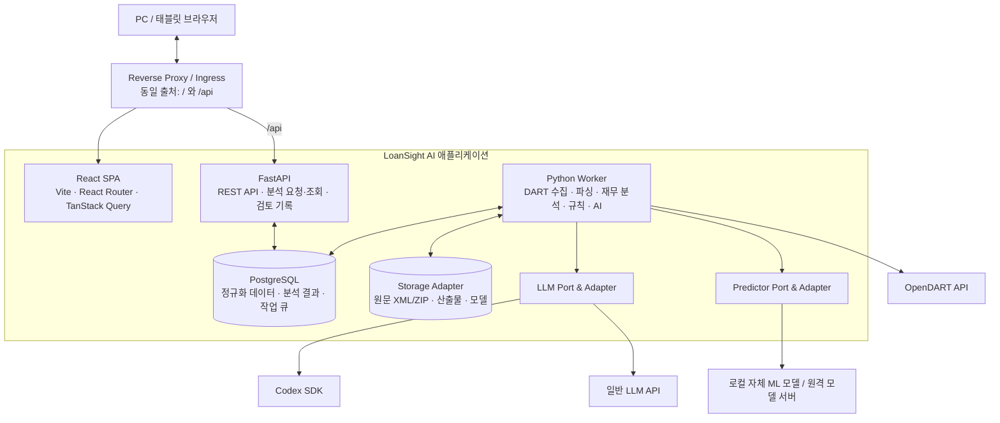
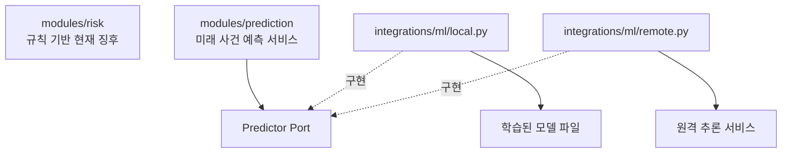
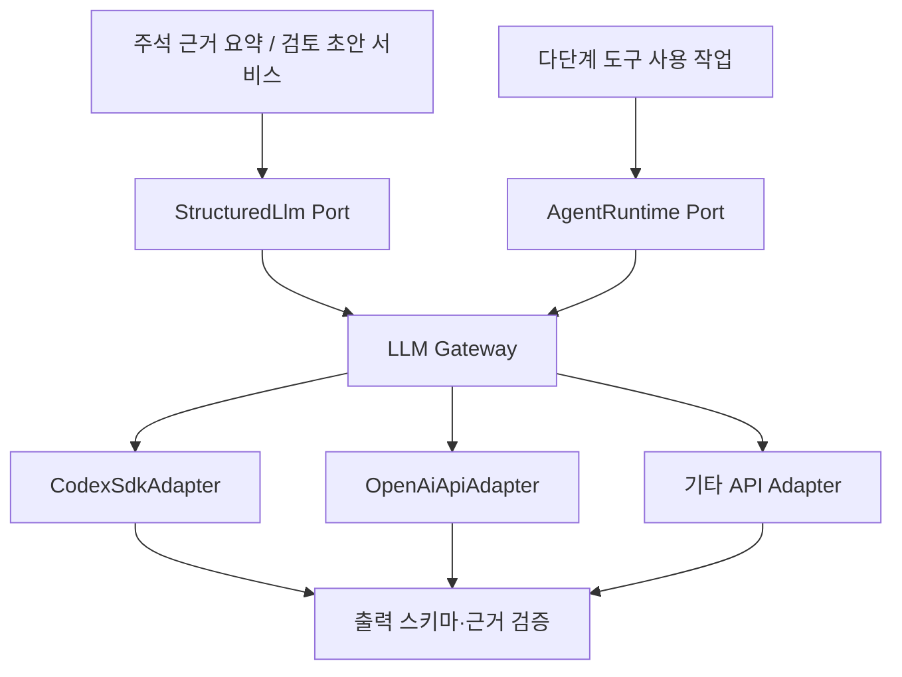
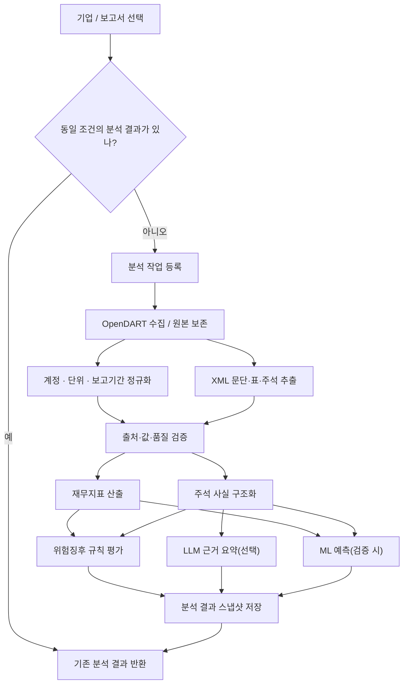

# LoanSight AI 전체 시스템 아키텍처

> **문서 버전:** v0.3 (설계 초안)  
> **정리일:** 2026-10-27  
> **기준:** 프로젝트 아키텍처 논의 및 제공된 「LoanSight AI 화면 설계서」  
> **기본 방향:** **SaaS 우선**, 동일 이미지로 **Self-hosted 지원**, **React SPA + FastAPI + Python Worker + PostgreSQL**

## 0. 문서의 결정 수준

이 문서는 지금까지 논의된 **개발 방향을 정리**한 것이며, 모든 구현 세부사항을 확정한 명세는 아니다.

| 구분 | 의미 |
|---|---|
| **채택** | 현재 논의에서 선택한 방향 |
| **잠정** | 구현 시 사용하되 요구사항에 따라 재검토 가능 |
| **보류** | 후속 설계에서 결정하며 현재 구현 범위에서 제외 |
| **권장** | 구체적 구현 방식에 대한 제안, 미확정 |

### 0.1 현재 기술 의사결정

| 주제 | 결정 및 방향 | 상태 |
|---|---|---|
| 제공 형태 | **SaaS 우선**, Self-hosted도 제공 | 채택 |
| 프론트엔드 | **React + Vite + TypeScript**, Next.js 미사용 | 채택 |
| 라우팅·UI | React Router, Tailwind CSS | 잠정 |
| 데이터 조회 캐시 | TanStack Query | 채택 |
| 백엔드 | **Python FastAPI** | 채택 |
| 분석 실행 | FastAPI와 동일 코드베이스의 **별도 Python Worker 프로세스** | 채택 |
| DB | PostgreSQL | 잠정 |
| 비동기 작업 | PostgreSQL 작업 테이블 기반 큐 | 잠정 |
| LLM | **Codex SDK / 일반 LLM API 교체 가능한 Port & Adapter** | 채택 |
| 자체 ML 모델 | `modules/prediction`에서 사용, `integrations/ml`에 실행 어댑터 | 채택 |
| 원문 저장 | 로컬 파일/PVC; 확장 시 객체 스토리지로 전환 가능 | 잠정 |
| SaaS 배포 | k3s 중심 | 채택 방향 |
| Self-hosted 배포 | Docker Compose 기반 간편 설치 | 채택 |
| 로그인·사용자 식별 | 상세 설계 **보류** | 보류 |
| PWA | HTTPS 및 기기별 설치 문제를 고려해 **후순위** | 보류 |
| Redis, RabbitMQ, 별도 API Gateway | 초기에는 도입하지 않음 | 잠정 제외 |
| MSA 분리 | 초기에는 채택하지 않음 | 제외 |

---

## 1. 시스템 목적과 경계

LoanSight AI는 **기업 여신 검토를 지원하는 공시 기반 분석 시스템**이다.

- 회사·보고서를 선택하여 재무정보와 기간별 변동을 확인한다.
- OpenDART의 정형 재무데이터와 사업보고서 원문을 확보한다.
- 재무지표를 계산하고, 업종별 위험징후 규칙을 평가한다.
- 주석에서 차입 만기, 재무약정, 보증, 담보, 소송 등 근거를 추출·구조화한다.
- 검증된 근거에 기반해 LLM 요약을 작성한다.
- 별도 검증을 거친 ML 모델이 있다면 미래 위험 사건 예측을 제공한다.
- 사용자는 확인 항목과 검토 메모를 관리한다.

**시스템 경계:** 여신 승인·거절, 은행 내부 신용등급 산정, 자산건전성 분류를 대신하지 않는다. 위험징후 단계와 미래 위험 사건 확률은 다른 결과다.

### 1.1 대응 화면

| 화면 ID | 화면 | 주요 서버 기능 |
|---|---|---|
| N-S01 | 기업 검색·업종 선택 | 기업·공시 검색, 업종 분류, 분석 요청 |
| N-S02 | 핵심 재무 요약 | 재무지표, 산식, 상환능력 조회 |
| N-S03 | 실적 변동·현금흐름 | 기간별 비교, 워터폴, 현금흐름·운전자본 |
| N-S04-1 | 주석 확인과 위험징후 패널 | 위험규칙 평가 결과, 업종 지표 |
| N-S04-2 | 주석 추출 근거·AI 요약 | 구조화된 주석 사실, 원문 위치, LLM 요약 |
| N-S05 | 위험 사건 예측과 근거 | ML 예측, 입력특징, 검증 상태 |
| N-S06 | 관련 뉴스 | 선택적 뉴스 수집·검증·연결 (**후순위**) |
| N-S07 | 담당자 체크·검토 메모 | 체크리스트, 검토 초안, 편집 기록 |
| N-S08 | 검증 기록 | 추출 품질, 계정 확보율, 모델 평가 (**내부 페이지 여부 미정**) |

> 화면 설계서의 기업명·수치·예측 확률은 일부 **레이아웃 예시**이므로 실제 수집·검증된 값으로 간주하지 않는다.

---

## 2. 전체 논리 아키텍처



### 2.1 책임 분리

**React SPA**
- 분석 화면, 데이터 테이블·차트, 검색 및 검토 UI를 제공한다.
- TanStack Query를 통해 서버 상태를 캐싱하고 화면 간 중복 조회를 줄인다.
- 재무지표·위험징후 등의 최종 계산 책임은 갖지 않는다.

**FastAPI**
- HTTP 요청·응답, 검색, 분석 실행 요청, 분석 결과 조회를 처리한다.
- 검토 목록·메모 등의 업무 데이터를 저장한다.
- 긴 분석 작업을 직접 처리하지 않고 작업을 등록한다.

**Python Worker**
- OpenDART 수집, 공시 XML 파싱, 정규화·검증을 수행한다.
- 재무지표 계산, 위험규칙 평가, 주석 추출, LLM 요약, 모델 추론을 수행한다.
- 작업 진행 상태 및 결과를 DB에 저장한다.

**PostgreSQL**
- 정형 원천 사실, 정규화 결과, 분석 스냅샷, 작업 상태, 검토 데이터를 보관한다.
- 동일 조건의 분석 중복 실행을 방지한다.

**파일 저장소**
- 원본 공시 ZIP/XML 및 큰 산출물·학습 모델 파일을 보관한다.
- 로컬 저장소와 원격 객체 저장소를 구현체로 분리한다.

---

## 3. 프로젝트 디렉터리 구조

초기에는 **단일 저장소(Monorepo) + 두 개의 배포 이미지(Frontend, Backend)** 로 시작한다. API와 Worker는 동일 Backend 이미지의 실행 명령만 다르게 한다.

```text
loansight-ai/
├── frontend/                         # React + Vite SPA
│   ├── src/
│   │   ├── app/                      # 앱 설정, 라우팅, QueryClient
│   │   │   ├── router.tsx
│   │   │   └── providers.tsx
│   │   ├── pages/                    # 화면 단위 진입점
│   │   ├── features/                 # 기능 단위 UI/상태/Query
│   │   │   ├── company/
│   │   │   ├── disclosure/
│   │   │   ├── financial/
│   │   │   ├── analysis/
│   │   │   ├── evidence/
│   │   │   ├── risk/
│   │   │   ├── prediction/
│   │   │   ├── review/
│   │   │   └── news/                 # 후순위
│   │   └── shared/
│   │       ├── api/                  # 공통 HTTP 클라이언트
│   │       ├── components/
│   │       ├── hooks/
│   │       ├── types/
│   │       └── utils/
│   ├── public/
│   ├── Dockerfile
│   ├── nginx.conf
│   ├── package.json
│   └── vite.config.ts
│
├── backend/                          # FastAPI + Python Worker
│   ├── app/
│   │   ├── main.py                  # FastAPI 진입점
│   │   ├── modules/                 # 기능별 업무·분석 로직
│   │   │   ├── company/             # 기업 검색, 업종 판정
│   │   │   ├── disclosure/          # 보고서/공시 메타데이터
│   │   │   ├── financial/           # 재무 정규화, 산식, 지표
│   │   │   ├── evidence/            # 주석 추출, 근거 위치, 사실 검증
│   │   │   ├── risk/                # 규칙 기반 현재 위험징후
│   │   │   ├── prediction/          # 미래 사건 예측 비즈니스 로직
│   │   │   │   ├── service.py
│   │   │   │   ├── ports.py         # Predictor 인터페이스
│   │   │   │   └── schemas.py
│   │   │   ├── analysis/            # 분석 실행, 결과 스냅샷
│   │   │   ├── benchmark/           # 업종 비교
│   │   │   ├── review/              # 검토 항목·메모
│   │   │   ├── validation/          # 추출·모델 검증 기록
│   │   │   └── news/                # 후순위
│   │   ├── integrations/            # 외부 시스템·모델 어댑터
│   │   │   ├── dart/
│   │   │   │   ├── client.py
│   │   │   │   └── collector.py
│   │   │   ├── llm/
│   │   │   │   ├── ports.py         # StructuredLlm, AgentRuntime
│   │   │   │   ├── gateway.py       # 공급자 선택·라우팅
│   │   │   │   └── providers/
│   │   │   │       ├── codex.py
│   │   │   │       └── openai_api.py
│   │   │   └── ml/
│   │   │       ├── local.py         # 로컬 모델 로딩·추론
│   │   │       └── remote.py        # 원격 추론 API
│   │   ├── worker/
│   │   │   ├── main.py              # Worker 진입점
│   │   │   └── tasks/               # 단계별 분석 작업
│   │   └── core/
│   │       ├── config.py
│   │       ├── database.py
│   │       ├── storage.py           # 저장소 Port 및 구현 연결
│   │       └── errors.py
│   ├── migrations/                   # Alembic
│   ├── tests/
│   ├── pyproject.toml
│   └── Dockerfile
│
├── ml-training/                      # 선택: 모델 학습·평가·실험
│   ├── datasets/
│   ├── training/
│   └── evaluation/
│
├── deploy/
│   ├── compose.yaml                  # Self-hosted / 로컬 운영
│   └── k8s/
│       ├── base/                     # Deployment, Service 등
│       └── overlays/
│           └── saas/                 # SaaS 설정(Kustomize)
│
├── scripts/                          # 설치, 업그레이드, 백업, 복구
├── docs/                             # 산식, 규칙, 데이터·API 계약
├── .env.example
└── README.md
```

**구조 원칙**

1. `modules/*`에는 **무엇을 분석하고 어떤 결과를 반환할지**에 관한 기능을 둔다.
2. `integrations/*`에는 **외부 시스템 또는 모델을 어떻게 호출할지**를 둔다.
3. `worker/*`는 기존 모듈을 조합해 실행하며, 별도의 두 번째 비즈니스 로직을 만들지 않는다.
4. 기능이 작으면 `service.py` 등 최소 파일부터 시작한다. 모든 모듈에 계층 구조를 강제하지 않는다.
5. 모델의 **학습 코드**는 운영 시 사용하는 **추론 어댑터**와 구분한다.

---

## 4. 위험징후 규칙과 자체 ML 모델의 경계

### 4.1 구분

| 대상 | 책임 | 위치 |
|---|---|---|
| 현재 위험징후 판정 | 재무비율·주석 사실을 규칙과 대조하여 경고/주의/관찰 등 산출 | `modules/risk` |
| 미래 위험 사건 예측 | 지정된 모델·특징 버전으로 추론 요청, 검증 여부 판단, 결과 저장 | `modules/prediction` |
| 로컬 자체 모델 실행 | 모델 로딩, 전처리 입출력 변환, 추론 | `integrations/ml/local.py` |
| 외부 모델 서버 실행 | HTTP/gRPC 등 호출, 타임아웃, 결과 변환 | `integrations/ml/remote.py` |
| 모델 학습·평가 | 데이터셋 구축, 학습, 지표·보정 성능 검증 | `ml-training/` |



**판단:** 자체 모델이 외부 서비스가 아니라 Python 프로세스 내에서 실행되더라도, `integrations/ml`에 추론 어댑터를 두는 구조를 사용한다. `risk`에 모델 종속 코드를 직접 넣지 않는다.

### 4.2 예측 모델 검증 제한

- 검증되지 않은 모델의 예측 확률을 실제 결과처럼 표시하지 않는다.
- 원리금 연체와 **공시에서 발견한 위험 사건**은 동일한 라벨이 아니다.
- 모델 입력에는 **기준일 당시 확보 가능했던 정보만** 사용한다(후속 공시 누출 방지).
- 사건 정의, 관찰 기간, 정답지 대조, 시간 분리, 평가·보정 결과를 기록한다.
- 모델 버전과 **특징 생성 버전**을 함께 저장한다.
- 조건을 충족하지 못하면 확률 대신 `표시 보류`를 반환한다.

---

## 5. LLM 연동 및 교체 가능 구조

Codex SDK와 일반 LLM API는 실행 능력이 다르므로, **공통 생성 인터페이스**와 **에이전트 실행 인터페이스**를 분리한다.



### 5.1 공통 규칙

- 비즈니스 모듈은 공급자 SDK를 직접 참조하지 않는다.
- 기능별로 공급자를 선택할 수 있다(예: 주석 요약, 검토 초안).
- LLM에 제공하는 수치는 **검증된 계산 결과**를 사용한다.
- 구조화 응답은 Pydantic으로 검증한다.
- 원문에 없는 사실, 금액, 출처가 생성되지 않았는지 별도 검증한다.
- 프롬프트·모델·공급자·출력 스키마·생성 설정의 버전을 기록한다.
- 같은 조건의 결과는 재사용한다.
- 공급자 미설정 또는 실패 시 핵심 재무 분석과 위험규칙은 독립적으로 동작한다.

### 5.2 설정 예시(개념)

```yaml
llm:
  tasks:
    note_summary: codex
    review_draft: api
  providers:
    codex:
      sandbox: read_only
    api:
      model: configured-model
```

이는 설정 형식의 예시이며 실제 라이브러리의 설정 스키마가 아니다. Codex는 설치 서버에서 별도로 인증한다. SaaS에서 **각 사용자별 Codex 구독 인증을 어떤 방식으로 지원할지**는 아직 결정하지 않는다. API 키와 인증정보는 코드나 배포 이미지에 포함하지 않는다.

---

## 6. 공시 데이터 파이프라인



### 6.1 수집 대상

| 목적 | 수집원/방법 | 원칙 |
|---|---|---|
| 기업 원장 | OpenDART 기업고유번호 목록 및 회사개황 | 로컬 캐시 후 갱신 |
| 공시 목록 | OpenDART 보고서 검색 | 신규·정정공시 확인 |
| 정형 재무제표 | OpenDART 재무정보 API | 연결(CFS) 우선, 없으면 별도(OFS) 전환 표시 |
| 주석 및 상세 항목 | 사업보고서 원문 XML/ZIP | 문단·표·원문 위치 보존 |
| 수동 입력 | 추후 입력 UI | 자동 수집값과 분리, 출처·기준일 기록 |

**원본 데이터는 수정하지 않고 보존한다.** 정정공시나 파서 버전 변경 시 기존 분석을 덮어쓰지 않고 새 분석 결과를 생성한다.

### 6.2 데이터 상태

다음 상태는 프론트엔드와 백엔드가 동일한 의미로 취급한다.

| 구분 | 상태 예시 | 의미 |
|---|---|---|
| 재무값 | `CONFIRMED`, `APPROXIMATE`, `MISSING`, `NOT_COMPUTABLE` | 확정, 근사, 미확보, 계산 불가 |
| 주석 | `DETECTED`, `EXPLICITLY_NONE`, `NOT_DETECTED`, `FAILED` | 검출, 원문에 없음 명시, 미검출, 추출 실패 |
| 모델 | `UNTRAINED`, `VALIDATING`, `VALIDATED`, `WITHHELD` | 미학습, 검증 중, 검증 완료, 표시 보류 |
| 검토 | `PENDING`, `CONFIRMED` | 미확인, 담당자 확인 완료 |

누락값을 0으로 대체하지 않는다. `NOT_DETECTED`와 `EXPLICITLY_NONE`은 구분한다. 현재 위험징후 단계와 미래 사건 확률도 혼동하지 않는다.

---

## 7. 데이터베이스 핵심 모델(논리 수준)

정확한 컬럼과 FK는 실제 구현 전에 확정한다.

| 테이블(안) | 역할 |
|---|---|
| `company` | 기업고유번호, 기업명, 시장, 업종 |
| `disclosure` | 접수번호, 보고서 종류, 사업연도, 접수일, 정정 관계 |
| `source_artifact` | 원문 파일 위치, 해시, 수집 시각 |
| `financial_fact` | 재무 계정, 회계 범위, 기간, 정규화 금액, 출처 |
| `note_evidence` | 추출 항목, 원문 위치, 검출 상태, 추출 버전 |
| `obligation` | 차입금, 지급보증, 만기, 담보 등 구조화 결과 |
| `analysis_run` | 특정 입력 및 분석 버전으로 수행한 실행·스냅샷 |
| `analysis_job` | 비동기 작업, 상태, 재시도, 실행 잠금 |
| `metric_result` | 계산 지표, 상태, 산식 버전 및 근거 |
| `risk_signal` | 규칙 ID/버전, 판정 단계, 근거 |
| `prediction_result` | 예측 모델/특징 버전, 결과, 검증 상태 |
| `review_item`, `review_draft` | 체크리스트, 사용자가 수정한 메모 (**사용자별 분리 정책 보류**) |
| `audit_event` | 분석 조건·수동 변경·검토 내용의 변경 기록 |

### 7.1 분석 실행 키

단순히 `corp_code`만으로 분석 결과를 식별하지 않는다.

```text
analysis_fingerprint = HASH(
  company / disclosure / accounting_scope / source_revision
  + parser_version / formula_version / industry_rule_version
  + risk_rule_version / input_override_revision
)
```

예측과 LLM 출력은 각각 모델/특징 버전, 프롬프트/공급자 등의 추가 키를 사용한다.

**`analysis_run_id`가 같으면 모든 화면은 같은 기준의 데이터를 조회**한다. 새 정정공시, 업종 수동 변경, 규칙 변경 등으로 입력이 바뀌면 새 분석 버전을 생성한다.

---

## 8. API 및 데이터 재사용 설계

### 8.1 API 초안

| 메서드 | 경로 | 설명 |
|---|---|---|
| GET | `/api/v1/companies` | 기업 검색 |
| GET | `/api/v1/companies/{corpCode}/disclosures` | 공시 목록 |
| POST | `/api/v1/analyses` | 분석 요청 또는 기존 실행 재사용 |
| GET | `/api/v1/analyses/{id}` | 실행 메타데이터 및 상태 |
| GET | `/api/v1/analyses/{id}/financials` | 재무지표·산식 |
| GET | `/api/v1/analyses/{id}/benchmarks` | 업종 비교 |
| GET | `/api/v1/analyses/{id}/evidences` | 주석 근거 |
| GET | `/api/v1/analyses/{id}/signals` | 규칙 기반 징후 |
| GET | `/api/v1/analyses/{id}/prediction` | 모델 결과 또는 보류 상태 |
| GET/PUT | `/api/v1/reviews/...` | 검토 항목·메모(권한 정책 결정 후) |

**원칙:** 프론트엔드가 화면마다 전체 분석을 재요청하지 않고, 저장된 `analysis_run_id`에 대응하는 필요한 데이터만 조회한다.

### 8.2 계층별 중복 방지

| 계층 | 구현 | 목적 |
|---|---|---|
| 브라우저 | TanStack Query + 공유 Query Key | 동일 결과 반복 요청 억제, 진행 중 요청 공유 |
| HTTP | ETag / 조건부 응답(선택) | 변경 없는 응답 본문 전송 최소화 |
| API/DB | `analysis_fingerprint` 조회 | 기존 완료 분석 결과 재사용 |
| 작업 큐 | 유니크 키 + 트랜잭션 | 동일 조건의 작업 중복 실행 방지 |
| 외부 DART | 접수번호별 원본 저장 | 공시 재다운로드 방지 |
| LLM | 입력 근거 해시 + 프롬프트·모델·설정 버전 | 동일 요약 재호출 최소화 |

**캐시 무효화:** 공시 정정, 파서·산식·규칙 변경, 수동 입력 수정 등은 새 버전/키를 생성한다. 분석 결과를 단순 TTL만으로 관리하지 않는다.

### 8.3 비동기 작업

```text
POST /analyses
  ├─ 동일한 완료 스냅샷 존재 → 기존 analysis_run_id 반환
  ├─ 동일한 진행 중 작업 존재 → 기존 job_id 반환
  └─ 신규 작업 필요 → job 등록(202 Accepted)
                             └─ Worker 실행 → 결과 저장
```

- 초기에는 PostgreSQL 작업 테이블과 `FOR UPDATE SKIP LOCKED`를 사용한다(잠정).
- 작업은 단계별 상태를 기록하고, **중복 실행에 안전한 멱등성**을 가진다.
- 실패한 일부 주석 추출 때문에 정상 재무제표 조회까지 모두 실패로 표시하지 않는다.
- `Celery + Redis/RabbitMQ`는 작업 규모가 커질 때 재검토한다.

---

## 9. SaaS와 Self-hosted 동시 지원

**애플리케이션 코드 및 이미지는 동일하게 유지하고 배포 설정만 분리한다.**

### 9.1 공통 빌드 아티팩트

1. `frontend` 이미지: Vite 빌드 산출물을 Nginx 등 정적 웹 서버로 제공.
2. `backend` 이미지: FastAPI와 Python Worker가 동일 코드·의존성을 사용하고 **시작 명령만 다름**.
3. PostgreSQL: 환경에 따라 컨테이너 DB 또는 관리형/외부 DB를 사용.

### 9.2 배포별 대응

| 구성 | Docker Compose (Self-hosted) | k3s (SaaS) |
|---|---|---|
| Frontend | `frontend` 서비스 | Deployment + Service |
| FastAPI | `api` 서비스 | Deployment + Service |
| Worker | `worker` 서비스 | Deployment |
| PostgreSQL | 로컬 DB 컨테이너 | 별도/관리형 DB 또는 StatefulSet |
| 원본 파일 | 바인드 마운트/볼륨 | PVC, 이후 S3 호환 저장소 선택 가능 |
| 라우팅 | Nginx `/`·`/api` | Traefik Ingress `/`·`/api` |
| 설정 | `.env` | ConfigMap + Secret |
| DB 마이그레이션 | 설치·업데이트 시 단발 실행 | 별도 Job으로 단발 실행 |

### 9.3 k3s 전환을 위한 필수 조건

- **API는 Stateless**: 요청 사이의 업무 상태를 API 프로세스 메모리에만 두지 않는다.
- **Worker는 Stateless**: 작업 진행상태와 결과를 DB/저장소에 보관한다.
- 내부 호출 시 Compose 컨테이너 이름을 비즈니스 코드에 하드코딩하지 않고 **환경변수로 연결**한다.
- 브라우저는 API 절대 호스트를 알 필요 없이 **동일 출처의 `/api` 경로**로 호출한다.
- 로컬 파일 저장 경로를 모듈에 직접 결합하지 않고 Storage Adapter 뒤로 숨긴다.
- DB 마이그레이션을 API 기동에 무조건 묶지 않는다(다중 Replica 충돌 방지).
- Readiness/Liveness 확인 엔드포인트를 제공한다.
- 다중 노드 k3s에서는 노드 종속 로컬 PVC 문제를 검토하고, 필요시 객체 저장소로 이전한다.

### 9.4 Self-hosted 설치

- Docker Compose 패키지와 사전 빌드 이미지를 제공한다.
- `.env.example`, 초기 실행, 업데이트, 백업·복구 스크립트를 둔다.
- 개발자용 Node.js/Python 런타임 설치 없이 컨테이너를 구동할 수 있게 한다(Docker는 필요).
- 데이터를 컨테이너 삭제와 무관한 볼륨에 보관한다.
- OpenDART 및 외부 LLM의 키·인증은 **설치 환경별**로 설정한다.
- 데이터 복구 시 DB와 원본 파일, 관련 설정을 일관되게 복원한다.

### 9.5 HTTPS와 PWA

- SaaS 공개 접속은 HTTPS를 제공한다.
- Self-hosted 초기 설치는 로컬 HTTP 접근을 우선한다. 원격 다중 기기에서 운영할 경우 HTTPS 도입을 별도로 안내한다.
- **PWA 설치, Service Worker 오프라인 모드, 푸시·동기화는 현재 구현 범위에서 제외**한다.
- 대신 초기부터 PC/태블릿 반응형 UI를 구현한다.

---

## 10. 로그인·사용자별 분리: 의도적으로 보류

**회원가입·로그인·익명 Workspace 토큰 등 구체적인 식별 방식은 아직 결정하지 않는다.** 이전에 논의한 랜덤 토큰 방식은 **확정된 요구사항이 아닌 검토안**이다.

현재 분리해서 생각할 데이터는 다음과 같다.

- **전역 공유 가능:** 기업 기본정보, 공개 공시 원본, 표준화 재무제표, 동일 조건의 공통 분석 결과.
- **사용자별 분리 필요:** 사용자가 선택한 기업 목록, 수동 입력 및 수정, 확인 체크리스트, 검토 메모.

**공개 SaaS로 여러 사용자의 검토 데이터를 저장하기 전에는 최소한의 사용자·작업공간 식별과 서버 측 접근 범위 제한을 반드시 결정해야 한다.** 공개 공시 자체는 민감도가 낮아도 사용자별 메모·입력값과 서버 측 LLM API 키·실행 비용은 별도 보호 대상이다.

현재 구현에서는 인증 체계를 미리 복잡하게 설계하지 않는다. 사용자 식별이 확정되기 전까지는 개인별 검토 데이터를 여러 익명 이용자에게 공유하는 기능을 공개하지 않는다.

---

## 11. 기본 운영·검증 원칙

### 11.1 데이터 정확성

- 원본과 정규화·계산·요약 데이터를 계층별로 구분한다.
- 계산식·데이터 출처·산식 버전을 API로 노출할 수 있도록 한다.
- 근사값은 이유와 함께 표시하고, 미확보/계산 불가를 0이나 정상으로 간주하지 않는다.
- 회계상 증감 분해를 실제 사업상 원인으로 단정하지 않는다.
- 주석 보증한도·보증금액·실제 대출잔액, 보증 제공·수취를 구분하고 중복 합산하지 않는다.

### 11.2 ML·LLM 검증

- LLM 출력은 정량 지표의 진실 원천(Source of Truth)이 아니다.
- ML 입력과 예측 결과에는 모델·특징 버전 및 검증 상태를 기록한다.
- 공시만으로 확인 가능한 사건의 예측과 실제 은행 대출 연체율을 혼동하지 않는다.
- LLM 결과 및 모델 결과가 없어도 재무·위험규칙 화면은 가능한 범위에서 제공한다.

### 11.3 최소 운영

- DB 및 원본 파일 백업, 복구 테스트.
- API와 Worker 로그에 `analysis_run_id`·`job_id`를 연결.
- 외부 API 타임아웃·재시도·쿼터 처리.
- SaaS에서는 익명 대량 호출로 발생하는 작업·LLM 비용을 통제할 최소한의 제한을 추가.
- 환경변수·Secret로 API 키 관리. 인증정보를 Docker 이미지·Git 저장소에 넣지 않음.

---

## 12. 단계별 개발 순서

| 단계 | 구현 범위 | 검증 목표 |
|---|---|---|
| **1. 프로젝트 골격** | React, FastAPI, PostgreSQL, Worker, Compose, k3s 기본 매니페스트 | 동일 이미지가 Compose/k3s에서 실행됨 |
| **2. 수집·저장** | 기업 검색, 보고서 선택, DART 수집, 원본 보관, 정규화 | 실기업 보고서의 재무 데이터와 근거 재현 |
| **3. 재무 MVP** | 공통 산식, N-S02·03, 분석 캐시 | 중복 수집·계산 없이 동일 결과 조회 |
| **4. 주석·규칙** | N-S04-1·04-2, 추출 검증, 업종 규칙 | 원문 근거를 따라가며 판정 확인 |
| **5. 검토 흐름** | N-S07, 체크리스트·검토 메모 | 분석 스냅샷과 검토 결과 연결(다중 사용자 공개 전 식별 정책 결정) |
| **6. AI 확장** | LLM Gateway, Codex/API Adapter, 요약 | 공급자를 교체해도 동일 출력 계약 유지 |
| **7. ML 예측** | Prediction Port, 자체 모델 Adapter, 학습·검증 | 검증 미충족 시 확률 표시 보류 |
| **8. 보완** | 업종 확대, 업종 비교, 뉴스, 검증 기록, PWA 검토 | 실데이터 품질·운영 지표 개선 |

**권장 구현 순서:** 먼저 실제 기업의 사업보고서 한 건을 **수집 → 정규화 → 재무지표 → 주석 근거 → 규칙 판정 → 화면 조회**까지 관통하는 수직 기능으로 구현한다. 이후 업종과 모델 기능을 확장한다.

---

## 13. 미결정 사항 및 다음 설계 대상

| 주제 | 현재 상태 | 결정이 필요한 시점 |
|---|---|---|
| 로그인·Workspace 식별 | **보류** | 여러 사용자에게 검토 기능을 공개하기 전 |
| PostgreSQL 작업 큐 vs 전문 큐 | PostgreSQL 잠정 | 실제 동시 실행·장시간 작업 측정 후 |
| PostgreSQL vs SQLite | PostgreSQL 잠정 | 설치형의 경량화 요구가 커질 때 |
| 저장소 방식 | 로컬 볼륨/PVC 잠정 | k3s 다중 노드 확장 전 |
| 업종 분류·복합 업종 기준 | 상세 규칙 미정 | 실제 데이터 수집·분류 검증 시 |
| 재무 산식 상세 | 산식·결측·근사 정책 검증 필요 | 지표 개발 전 |
| 주석 추출 품질 기준 | 정답지·정밀도/재현율 기준 미정 | 주석 기능 도입 전 |
| ML 사건 라벨 및 보정 | 미정 | 예측 확률 대외 표시 전 |
| Codex 인증·운영 정책 | 설치 형태별 미정 | Codex Adapter 운영 전 |
| PWA·Self-hosted HTTPS | 후순위 | 설치형 태블릿 PWA를 제공할 때 |
| 업종 비교 최소 표본 | 미정 | 업종 비교 결과 표시 전 |

---

## 14. 최종 요약

**LoanSight AI는 React(Vite) SPA, FastAPI, 동일 코드베이스의 Python Worker, PostgreSQL을 사용하는 경량 분석 시스템으로 설계한다.**

- **SaaS를 우선** 구현하고 **Docker Compose 기반 Self-hosted**도 제공한다.
- **k3s 이전을 쉽게** 하기 위해 Stateless API/Worker, 공통 이미지, 환경변수 설정, 저장소 Adapter를 사용한다.
- **공개 공시·동일 조건의 분석 결과는 공유**하고 중복 수집·계산·LLM 호출을 최소화한다.
- **현재 위험징후(`risk`)와 미래 사건 예측(`prediction`)을 분리**하며, 자체 모델 실행은 `integrations/ml` Adapter에 둔다.
- **Codex SDK와 일반 LLM API를 교체 가능하게** 공통 인터페이스를 둔다.
- **로그인·사용자 식별, PWA는 후순위**로 두되, 다중 사용자 공개 이전에 사용자별 검토 데이터 격리 방식은 결정해야 한다.

> **참고 문서:** 사용자 제공 「LoanSight AI 화면 설계서 v0.0.2_KB컬러.pdf」. 화면 구성, 상태 표현, 공시 근거 추적 및 검증 요구를 반영했으며, 기술 스택·배포 구조·디렉터리 구성은 이후 대화에서 정한 아키텍처 방향을 반영했다.
