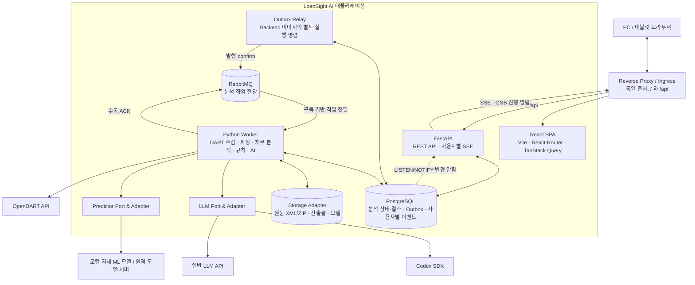
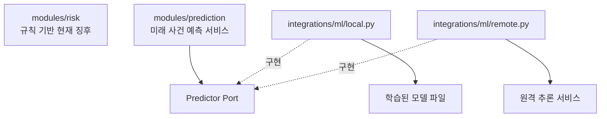
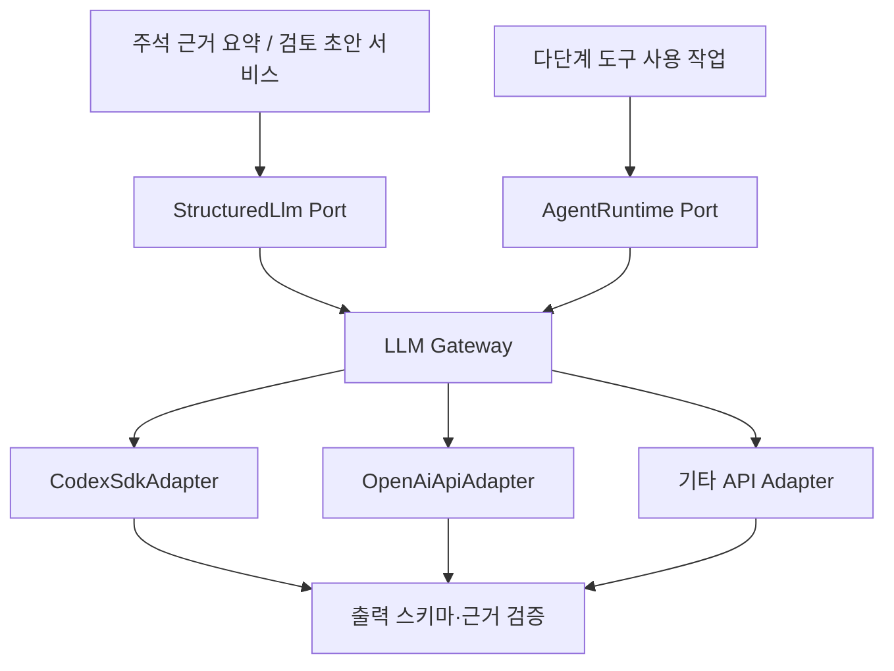
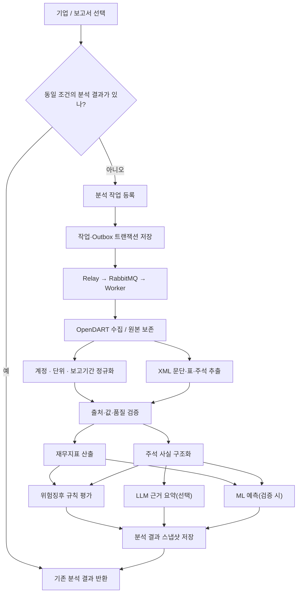

# LoanSight AI 전체 시스템 아키텍처

> **문서 버전:** v0.3 (설계 초안)  
> **정리일:** 2026-10-27  
> **기준:** 프로젝트 아키텍처 논의 및 제공된 「LoanSight AI 화면 설계서」  
> **기본 방향:** **SaaS 우선**, 동일 이미지로 **Self-hosted 지원**, **React SPA + FastAPI + Python Worker + PostgreSQL + RabbitMQ**, **SSE 진행 알림**
> **v0.3 추가 반영:** RabbitMQ 작업 전달, SSE 상태 복구, GNB 사용자별 작업 표시, 업무 범위·예측 제공 조건 정합화

## 0. 문서의 결정 수준

이 문서는 지금까지 논의된 **개발 방향을 정리**한 것이며, 모든 구현 세부사항을 확정한 명세는 아니다.

| 구분 | 의미 |
|---|---|
| **채택** | 현재 논의에서 선택한 방향 |
| **잠정** | 구현 시 사용하되 요구사항에 따라 재검토 가능 |
| **보류** | 후속 설계에서 결정하며 현재 구현 범위에서 제외 |
| **권장** | 구체적 구현 방식에 대한 제안, 미확정 |

### 0.1 현재 기술 의사결정

| 주제 | 결정 및 방향 | 상태 |
|---|---|---|
| 제공 형태 | **SaaS 우선**, Self-hosted도 제공 | 채택 |
| 프론트엔드 | **React + Vite + TypeScript**, Next.js 미사용 | 채택 |
| 라우팅·UI | React Router, Tailwind CSS | 잠정 |
| 데이터 조회 캐시 | TanStack Query | 채택 |
| 백엔드 | **Python FastAPI** | 채택 |
| 분석 실행 | FastAPI와 동일 코드베이스의 **별도 Python Worker 프로세스** | 채택 |
| DB | PostgreSQL | 잠정 |
| 비동기 작업 | **RabbitMQ** 구독 기반 작업 전달, PostgreSQL에 작업 상태·결과 보관 | 채택 |
| 실시간 진행 알림 | **SSE**, 앱 공통 연결로 GNB와 상세 화면 갱신 | 채택 |
| 상태 변경 내부 알림 | PostgreSQL `LISTEN/NOTIFY`로 API에 알림, 영속 이벤트로 재생 | 잠정 |
| 작업 발행 일관성 | **Transactional Outbox**, publisher confirm 및 멱등 처리 | 채택 |
| LLM | **Codex SDK / 일반 LLM API 교체 가능한 Port & Adapter** | 채택 |
| 자체 ML 모델 | `modules/prediction`에서 사용, `integrations/ml`에 실행 어댑터 | 채택 |
| 원문 저장 | 로컬 파일/PVC; 확장 시 객체 스토리지로 전환 가능 | 잠정 |
| SaaS 배포 | k3s 중심 | 채택 방향 |
| Self-hosted 배포 | Docker Compose 기반 간편 설치 | 채택 |
| 로그인·사용자 식별 | 방식 **보류**, 사용자별 GNB·SSE 공개 전 서버 측 식별·격리 필수 | 방식 보류 |
| PWA | HTTPS 및 기기별 설치 문제를 고려해 **후순위** | 보류 |
| Redis, 별도 API Gateway | 초기에는 도입하지 않음 | 잠정 제외 |
| MSA 분리 | 초기에는 채택하지 않음 | 제외 |

---

## 1. 시스템 목적과 경계

LoanSight AI는 **기업 여신 검토를 지원하는 공시 기반 분석 시스템**이다.

- 회사·보고서를 선택하여 재무정보와 기간별 변동을 확인한다.
- OpenDART의 정형 재무데이터와 사업보고서 원문을 확보한다.
- 재무지표를 계산하고, 업종별 위험징후 규칙을 평가한다.
- 주석에서 차입 만기, 재무약정, 보증, 담보, 소송 등 근거를 추출·구조화한다.
- 검증된 근거에 기반해 LLM 요약을 작성한다.
- 별도 검증을 거친 ML 모델이 있다면 향후 12개월 위험 사건 예측 확률을 제공한다. 미학습·검증 중·검증 미충족 시 확률을 표시하지 않고 상태와 보류 사유를 제공한다.
- 사용자는 확인 항목과 검토 메모를 관리한다.

**시스템 경계:** 여신 승인·거절, 은행 내부 신용등급 산정, 자산건전성 분류를 대신하지 않는다. 위험징후 단계와 미래 위험 사건 확률은 다른 결과다.

### 1.1 대응 화면

| 화면 ID | 화면 | 주요 서버 기능 |
|---|---|---|
| N-S01 | 기업 검색·업종 선택 | 기업·공시 검색, 업종 분류, 분석 요청 |
| N-S02 | 핵심 재무 요약 | 재무지표, 산식, 상환능력 조회 |
| N-S03 | 실적 변동·현금흐름 | 기간별 비교, 워터폴, 현금흐름·운전자본 |
| N-S04-1 | 주석 확인과 위험징후 패널 | 위험규칙 평가 결과, 업종 지표 |
| N-S04-2 | 주석 추출 근거·AI 요약 | 구조화된 주석 사실, 원문 위치, LLM 요약 |
| N-S05 | 12개월 위험 사건 예측과 근거 | 검증 충족 시 확률, 미충족 시 표시 보류, 입력특징·검증 상태 |
| N-S06 | 관련 뉴스 | 선택적 뉴스 수집·검증·연결 (**후순위**) |
| N-S07 | 담당자 체크·검토 메모 | 체크리스트, 검토 초안, 편집 기록 |
| N-S08 | 검증 기록 | 추출 품질, 계정 확보율, 모델 평가 (**내부 페이지 여부 미정**) |
| 공통 GNB | 내 분석 작업·알림 | 사용자별 대기·진행·완료·실패 목록, 미확인 배지, 상세 이동 |

> 화면 설계서의 기업명·수치·예측 확률은 일부 **레이아웃 예시**이므로 실제 수집·검증된 값으로 간주하지 않는다.

### 1.2 업무 범위와 검증 기준

업무 범위는 기획안 v2.0·요구사항/PRD/기능명세서 v0.0.4·WBS v1.1에 연결한다. 상세 기획 원문은 별도 [docs 저장소](https://github.com/loansight-ai/docs)에서 관리하고, 이 문서는 구현 구조·데이터 계약·제공 조건을 정의한다.

| 영역 | 구현 범위·제한 |
|---|---|
| 대상 업종 | 제조·건설·도소매·부동산 임대 4개 업종 |
| 제외 업종 | 장비/물품 렌탈·운수/창고·금융/보험·지주/스팩·부동산 관리/중개 |
| 재무 분석 | 영업이익·현금흐름·차입/상환·운전자본 시각화, 실적 변동 기여도 분석 |
| 주석 | 공통 주석 6항목과 업종별 사전 기반 추출·구조화·요약, 원문 구간·교차참조 보존 |
| 현재 위험징후 | 6개 판단 축과 경고/주의/관찰을 표시하는 N-S04 패널. N-S04-1·04-2로 규칙 판정과 근거·요약을 구분 |
| 미래 사건 예측 | 재무·주석 결합 12개월 위험 사건 예측, 재무 단독 기준 모델과 비교 검증. 검증 조건 충족 시에만 확률 표시 |
| 검토 | 담당자 확인 체크와 검토 기록 초안·수정 이력. 최종 여신 판단은 담당자 책임 |
| 업종 비교·뉴스 | 비교 가능한 업종 분포와 근거 제공, 최소 비교 표본 미정. 뉴스는 보완 기능이며 초기 예측 모델 입력에서 제외 |

- 공통 주석 6항목·6개 판단 축의 상세 명칭과 매핑은 기능명세·화면 설계에 맞춰 구현 전에 확정한다. 위험 단계의 수치 기준은 팀 가설이며 현직자 확인과 검증이 필요하다.
- 주석의 제공/수취·현재/전기·한도/잔액을 구분한다. 검출/공시상 없음/미검출/추출 실패를 구분하고, 미검출·금액 미기재를 0/없음으로 바꾸지 않는다.
- 요구 43개·기능 41개·화면 8개·미정 질문 20개, WBS v1.1의 69개 작업을 구현·검수에 연결한다. N-S04의 세부 분할과 공통 GNB는 이 문서의 구현 관점 표현이며 기존 화면 수의 변경을 뜻하지 않는다.
- 기능 검증 15곳·정답지 5곳은 논의가 필요한 표본 계획이다. 모델 학습·평가, 주석 추출, 계정 확보율 검증의 표본과 구분하며 실제 검증 완료나 성능을 의미하지 않는다.
- 예측 사건·라벨·확률 제공 조건은 4.2절을 따른다. 규칙 단계·미래 모델 확률·담당자 체크는 별도로 관리한다.

---

## 2. 전체 논리 아키텍처



### 2.1 책임 분리

**React SPA**
- 분석 화면, 데이터 테이블·차트, 검색 및 검토 UI를 제공한다.
- TanStack Query를 통해 서버 상태를 캐싱하고 화면 간 중복 조회를 줄인다.
- 앱 공통 Provider에서 사용자 범위의 SSE 연결을 유지하고 GNB와 상세 화면에 상태를 반영한다.
- 새로고침·재방문 시 서버의 작업 목록을 조회한 뒤 SSE를 구독하여 상태를 복원한다.
- 재무지표·위험징후 등의 최종 계산 책임은 갖지 않는다.

**FastAPI**
- HTTP 요청·응답, 검색, 분석 실행 요청, 분석 결과 조회를 처리한다.
- 검토 목록·메모 등의 업무 데이터를 저장한다.
- 긴 분석 작업을 직접 처리하지 않고 작업을 등록한다.
- 작업·사용자 연결·Outbox를 트랜잭션으로 저장하고, 권한 범위에 맞는 작업 목록과 SSE를 제공한다.

**Outbox Relay / RabbitMQ**
- Relay는 DB에 확정된 발행 요청을 RabbitMQ로 전달하고 publisher confirm을 확인한다.
- RabbitMQ는 Worker에 작업을 전달하고 미확인 메시지의 재전달을 지원한다.
- API·Worker·Relay는 동일 Backend 이미지를 사용하며 실행 명령과 역할을 구분한다.

**Python Worker**
- OpenDART 수집, 공시 XML 파싱, 정규화·검증을 수행한다.
- 재무지표 계산, 위험규칙 평가, 주석 추출, LLM 요약, 모델 추론을 수행한다.
- 작업 진행 상태 및 결과를 DB에 저장한다.
- RabbitMQ를 구독하고 단계별 상태·영속 이벤트를 저장한 뒤 해당 작업 메시지를 ACK한다.
- 브라우저와 SSE 연결이 없어도 분석을 계속한다.

**PostgreSQL**
- 정형 원천 사실, 정규화 결과, 분석 스냅샷, 작업 상태, 검토 데이터를 보관한다.
- 동일 조건의 분석 중복 실행을 방지한다.
- 작업·결과·사용자 연결·알림 확인 여부·이벤트·Outbox의 기준 저장소다. `NOTIFY`는 변경 알림으로만 사용한다.

**파일 저장소**
- 원본 공시 ZIP/XML 및 큰 산출물·학습 모델 파일을 보관한다.
- 로컬 저장소와 원격 객체 저장소를 구현체로 분리한다.

---

## 3. 프로젝트 디렉터리 구조

초기에는 **단일 저장소(Monorepo) + 두 개의 애플리케이션 배포 이미지(Frontend, Backend)** 로 시작한다. API·Worker·Outbox Relay는 동일 Backend 이미지의 실행 명령만 다르게 한다. PostgreSQL과 RabbitMQ는 별도 인프라 이미지 또는 외부 서비스로 제공한다.

아래는 구현 목표 구조다. 현재 저장소는 설계·협업 문서 단계이며 애플리케이션 골격·실행 환경은 아직 생성되지 않았다. 로컬 `docs/`에는 코드와 함께 변경하는 산식·규칙·데이터·API 계약을 두고, 기획·수행일지·제출·발표 자료는 별도 docs 저장소에서 관리한다.

```text
loansight-ai/
├── frontend/                         # React + Vite SPA
│   ├── src/
│   │   ├── app/                      # 앱 설정, 라우팅, QueryClient
│   │   │   ├── router.tsx
│   │   │   ├── providers.tsx
│   │   │   └── task-events.tsx       # 앱 공통 SSE 연결·복원
│   │   ├── pages/                    # 화면 단위 진입점
│   │   ├── features/                 # 기능 단위 UI/상태/Query
│   │   │   ├── company/
│   │   │   ├── disclosure/
│   │   │   ├── financial/
│   │   │   ├── analysis/
│   │   │   ├── tasks/               # GNB 작업 목록·진행 상태·알림 확인
│   │   │   ├── evidence/
│   │   │   ├── risk/
│   │   │   ├── prediction/
│   │   │   ├── review/
│   │   │   └── news/                 # 후순위
│   │   └── shared/
│   │       ├── api/                  # 공통 HTTP 클라이언트
│   │       ├── components/
│   │       ├── hooks/
│   │       ├── types/
│   │       └── utils/
│   ├── public/
│   ├── Dockerfile
│   ├── nginx.conf
│   ├── package.json
│   └── vite.config.ts
│
├── backend/                          # FastAPI + Python Worker
│   ├── app/
│   │   ├── main.py                  # FastAPI 진입점
│   │   ├── modules/                 # 기능별 업무·분석 로직
│   │   │   ├── company/             # 기업 검색, 업종 판정
│   │   │   ├── disclosure/          # 보고서/공시 메타데이터
│   │   │   ├── financial/           # 재무 정규화, 산식, 지표
│   │   │   ├── evidence/            # 주석 추출, 근거 위치, 사실 검증
│   │   │   ├── risk/                # 규칙 기반 현재 위험징후
│   │   │   ├── prediction/          # 미래 사건 예측 비즈니스 로직
│   │   │   │   ├── service.py
│   │   │   │   ├── ports.py         # Predictor 인터페이스
│   │   │   │   └── schemas.py
│   │   │   ├── analysis/            # 분석 실행, 결과 스냅샷
│   │   │   ├── tasks/               # 사용자별 작업 연결, 목록·이벤트·확인 상태
│   │   │   ├── benchmark/           # 업종 비교
│   │   │   ├── review/              # 검토 항목·메모
│   │   │   ├── validation/          # 추출·모델 검증 기록
│   │   │   └── news/                # 후순위
│   │   ├── integrations/            # 외부 시스템·모델 어댑터
│   │   │   ├── messaging/           # RabbitMQ 발행·구독 어댑터
│   │   │   ├── dart/
│   │   │   │   ├── client.py
│   │   │   │   └── collector.py
│   │   │   ├── llm/
│   │   │   │   ├── ports.py         # StructuredLlm, AgentRuntime
│   │   │   │   ├── gateway.py       # 공급자 선택·라우팅
│   │   │   │   └── providers/
│   │   │   │       ├── codex.py
│   │   │   │       └── openai_api.py
│   │   │   └── ml/
│   │   │       ├── local.py         # 로컬 모델 로딩·추론
│   │   │       └── remote.py        # 원격 추론 API
│   │   ├── worker/
│   │   │   ├── main.py              # Worker 진입점
│   │   │   └── tasks/               # 단계별 분석 작업
│   │   ├── messaging/
│   │   │   ├── outbox_relay.py      # Outbox 전달·발행 확인·재시도
│   │   │   └── notifications.py     # LISTEN/NOTIFY 수신·연결 복구
│   │   └── core/
│   │       ├── config.py
│   │       ├── database.py
│   │       ├── storage.py           # 저장소 Port 및 구현 연결
│   │       └── errors.py
│   ├── migrations/                   # Alembic
│   ├── tests/
│   ├── pyproject.toml
│   └── Dockerfile
│
├── ml-training/                      # 선택: 모델 학습·평가·실험
│   ├── datasets/
│   ├── training/
│   └── evaluation/
│
├── deploy/
│   ├── compose.yaml                  # Self-hosted / 로컬 운영
│   └── k8s/
│       ├── base/                     # Deployment, Service 등
│       └── overlays/
│           └── saas/                 # SaaS 설정(Kustomize)
│
├── scripts/                          # 설치, 업그레이드, 백업, 복구
├── docs/                             # 산식, 규칙, 데이터·API 계약
├── .env.example
└── README.md
```

**구조 원칙**

1. `modules/*`에는 **무엇을 분석하고 어떤 결과를 반환할지**에 관한 기능을 둔다.
2. `integrations/*`에는 **외부 시스템 또는 모델을 어떻게 호출할지**를 둔다.
3. `worker/*`는 기존 모듈을 조합해 실행하며, 별도의 두 번째 비즈니스 로직을 만들지 않는다.
4. 기능이 작으면 `service.py` 등 최소 파일부터 시작한다. 모든 모듈에 계층 구조를 강제하지 않는다.
5. 모델의 **학습 코드**는 운영 시 사용하는 **추론 어댑터**와 구분한다.

---

## 4. 위험징후 규칙과 자체 ML 모델의 경계

### 4.1 구분

| 대상 | 책임 | 위치 |
|---|---|---|
| 현재 위험징후 판정 | 재무비율·주석 사실을 규칙과 대조하여 경고/주의/관찰 등 산출 | `modules/risk` |
| 미래 위험 사건 예측 | 지정된 모델·특징 버전으로 추론 요청, 검증 여부 판단, 결과 저장 | `modules/prediction` |
| 로컬 자체 모델 실행 | 모델 로딩, 전처리 입출력 변환, 추론 | `integrations/ml/local.py` |
| 외부 모델 서버 실행 | HTTP/gRPC 등 호출, 타임아웃, 결과 변환 | `integrations/ml/remote.py` |
| 모델 학습·평가 | 데이터셋 구축, 학습, 지표·보정 성능 검증 | `ml-training/` |



**판단:** 자체 모델이 외부 서비스가 아니라 Python 프로세스 내에서 실행되더라도, `integrations/ml`에 추론 어댑터를 두는 구조를 사용한다. `risk`에 모델 종속 코드를 직접 넣지 않는다.

### 4.2 위험 사건 정의와 예측 확률 제공 조건

**예측 기간은 기준일 이후 12개월**이다. 재무 단독 기준 모델과 재무·주석 결합 모델을 같은 평가 표본에서 비교한다. 규칙 위험 단계와 예측 확률은 서로 다른 결과이며, 예측을 여신 승인·거절이나 은행 내부 신용등급으로 해석하지 않는다.

위험 사건의 후보 범위는 원리금 연체·기한이익상실·지급거절·회생/채권은행 관리절차 신청·감사의견 변형/계속기업 불확실성이다. 상환과 무관한 관리종목·상장폐지는 제외한다. 후보 사건은 공시 원문과 대조하며, 공시에서 확인된 사건을 실제 은행 대출 연체와 동일시하지 않는다. 유형별 심각도, 복합 라벨 구성, 사건 인정·발생일 판정, 중복 사건 처리, 12개월 추적 미완료 표본 처리, 모델 수용·보정 기준은 미정이다.

후보 사건 범위와 예측 기간은 정해진 개발 범위이고, 학습 정답 라벨의 세부 판정 규칙은 후속 설계 대상이다. 서로 다른 유형을 하나의 복합 사건으로 묶을지, 유형별 확률을 제공할지도 라벨 정의 시 확정한다. 감사의견 변형 등 모든 후보 사건을 실제 원리금 연체로 이름 붙이지 않는다.

- 모델 입력에는 **기준일 당시 확보 가능했던 정보만** 사용한다. 사건 라벨 확인을 위한 후속 공시가 입력 특징에 섞이지 않도록 한다.
- 기업·시간 분리, 향후 12개월 추적, 정답지와 공시 원문 대조를 검증한다. 같은 평가 표본에서 기준/결합 모델의 성능과 확률 보정 결과를 비교한다.
- 사건 정의·라벨 버전, 기준일·예측 기간, 모델·**특징 생성 버전**, 평가·보정 결과와 검증 상태를 기록한다. 확률을 표시할 때 무엇의 12개월 확률인지 함께 표시한다.
- 예측 확률은 검증 조건을 충족한 모델에 한해 제공한다. 미학습·검증 중·검증 미충족 시 확률을 표시하지 않고 상태와 보류 사유를 제공한다. API의 확률 값은 `null`로 반환하고 0이나 예시 확률로 대체하지 않는다.
- 모델 상태는 `UNTRAINED`, `VALIDATING`, `VALIDATED`, `WITHHELD`로 구분한다. 검증 중 등 미제공 상태는 UI에서 `표시 보류`와 구체적인 상태·사유로 설명한다. 검증 결과는 모델·특징·사건 정의의 해당 버전에 대응해야 한다.
- 수용·보정 기준을 확정하고 충족 여부를 검증하기 전에는 모델의 확률 제공을 허용하지 않는다. ML이 없어도 재무 분석과 현재 위험규칙 화면은 가능한 범위에서 제공한다.

---

## 5. LLM 연동 및 교체 가능 구조

Codex SDK와 일반 LLM API는 실행 능력이 다르므로, **공통 생성 인터페이스**와 **에이전트 실행 인터페이스**를 분리한다.



### 5.1 공통 규칙

- 비즈니스 모듈은 공급자 SDK를 직접 참조하지 않는다.
- 기능별로 공급자를 선택할 수 있다(예: 주석 요약, 검토 초안).
- LLM에 제공하는 수치는 **검증된 계산 결과**를 사용한다.
- 구조화 응답은 Pydantic으로 검증한다.
- 원문에 없는 사실, 금액, 출처가 생성되지 않았는지 별도 검증한다.
- 프롬프트·모델·공급자·출력 스키마·생성 설정의 버전을 기록한다.
- 같은 조건의 결과는 재사용한다.
- 공급자 미설정 또는 실패 시 핵심 재무 분석과 위험규칙은 독립적으로 동작한다.

### 5.2 설정 예시(개념)

```yaml
llm:
  tasks:
    note_summary: codex
    review_draft: api
  providers:
    codex:
      sandbox: read_only
    api:
      model: configured-model
```

이는 설정 형식의 예시이며 실제 라이브러리의 설정 스키마가 아니다. Codex는 설치 서버에서 별도로 인증한다. SaaS에서 **각 사용자별 Codex 구독 인증을 어떤 방식으로 지원할지**는 아직 결정하지 않는다. API 키와 인증정보는 코드나 배포 이미지에 포함하지 않는다.

---

## 6. 공시 데이터 파이프라인



### 6.1 수집 대상

| 목적 | 수집원/방법 | 원칙 |
|---|---|---|
| 기업 원장 | OpenDART 기업고유번호 목록 및 회사개황 | 로컬 캐시 후 갱신 |
| 공시 목록 | OpenDART 보고서 검색 | 신규·정정공시 확인 |
| 정형 재무제표 | OpenDART 재무정보 API | 연결(CFS) 우선, 없으면 별도(OFS) 전환 표시 |
| 주석 및 상세 항목 | 사업보고서 원문 XML/ZIP | 문단·표·원문 위치 보존 |
| 수동 입력 | 추후 입력 UI | 자동 수집값과 분리, 출처·기준일 기록 |

**원본 데이터는 수정하지 않고 보존한다.** 정정공시나 파서 버전 변경 시 기존 분석을 덮어쓰지 않고 새 분석 결과를 생성한다.

### 6.2 데이터 상태

다음 상태는 프론트엔드와 백엔드가 동일한 의미로 취급한다.

| 구분 | 상태 예시 | 의미 |
|---|---|---|
| 재무값 | `CONFIRMED`, `APPROXIMATE`, `MISSING`, `NOT_COMPUTABLE` | 확정, 근사, 미확보, 계산 불가 |
| 주석 | `DETECTED`, `EXPLICITLY_NONE`, `NOT_DETECTED`, `FAILED` | 검출, 원문에 없음 명시, 미검출, 추출 실패 |
| 모델 | `UNTRAINED`, `VALIDATING`, `VALIDATED`, `WITHHELD` | 미학습, 검증 중, 검증 완료, 표시 보류 |
| 검토 | `PENDING`, `CONFIRMED` | 미확인, 담당자 확인 완료 |
| 작업 | `QUEUED`, `RUNNING`, `RETRY_WAIT`, `SUCCEEDED`, `PARTIAL_SUCCEEDED`, `FAILED` | 대기, 실행, 재시도 대기, 완료, 일부 완료, 실패 |

누락값을 0으로 대체하지 않는다. `NOT_DETECTED`와 `EXPLICITLY_NONE`은 구분한다. 현재 위험징후 단계와 미래 사건 확률도 혼동하지 않는다.

---

## 7. 데이터베이스 핵심 모델(논리 수준)

정확한 컬럼과 FK는 실제 구현 전에 확정한다.

| 테이블(안) | 역할 |
|---|---|
| `company` | 기업고유번호, 기업명, 시장, 업종 |
| `disclosure` | 접수번호, 보고서 종류, 사업연도, 접수일, 정정 관계 |
| `source_artifact` | 원문 파일 위치, 해시, 수집 시각 |
| `financial_fact` | 재무 계정, 회계 범위, 기간, 정규화 금액, 출처 |
| `note_evidence` | 추출 항목, 원문 위치, 검출 상태, 추출 버전 |
| `obligation` | 차입금, 지급보증, 만기, 담보 등 구조화 결과 |
| `analysis_run` | 특정 입력 및 분석 버전으로 수행한 실행·스냅샷 |
| `analysis_job` | 작업 상태·단계, attempt, heartbeat, 실행 임대·소유권, 재시도 시각·오류 |
| `outbox_message` | 작업과 함께 저장하는 발행 요청, 고유 message_id, 발행 확인·재시도 |
| `user_analysis_task` | 사용자·Workspace와 공유 분석의 연결, 최근 확인 시각·확인한 완료 버전 |
| `task_event` | 수신 사용자·Workspace별 영속 이벤트, 스트림 순번, 작업·분석 ID와 상태 버전 |
| `metric_result` | 계산 지표, 상태, 산식 버전 및 근거 |
| `risk_signal` | 규칙 ID/버전, 판정 단계, 근거 |
| `prediction_result` | 모델·특징·사건 정의 버전, 기준일·12개월 예측 기간, 확률 또는 미제공 상태·사유, 검증 상태 |
| `review_item`, `review_draft` | 체크리스트, 사용자가 수정한 메모 (**사용자별 분리 정책 보류**) |
| `audit_event` | 분석 조건·수동 변경·검토 내용의 변경 기록 |

### 7.1 분석 실행 키

단순히 `corp_code`만으로 분석 결과를 식별하지 않는다.

```text
analysis_fingerprint = HASH(
  company / disclosure / accounting_scope / source_revision
  + parser_version / formula_version / industry_rule_version
  + risk_rule_version / input_override_revision
)
```

예측과 LLM 출력은 각각 모델/특징 버전, 프롬프트/공급자 등의 추가 키를 사용한다.

**`analysis_run_id`가 같으면 모든 화면은 같은 기준의 데이터를 조회**한다. 새 정정공시, 업종 수동 변경, 규칙 변경 등으로 입력이 바뀌면 새 분석 버전을 생성한다.

---

## 8. API 및 데이터 재사용 설계

### 8.1 API 초안

| 메서드 | 경로 | 설명 |
|---|---|---|
| GET | `/api/v1/companies` | 기업 검색 |
| GET | `/api/v1/companies/{corpCode}/disclosures` | 공시 목록 |
| POST | `/api/v1/analyses` | 분석 요청 또는 기존 실행 재사용 |
| GET | `/api/v1/analyses/{id}` | 실행 메타데이터 및 상태 |
| GET | `/api/v1/analyses/{id}/financials` | 재무지표·산식 |
| GET | `/api/v1/analyses/{id}/benchmarks` | 업종 비교 |
| GET | `/api/v1/analyses/{id}/evidences` | 주석 근거 |
| GET | `/api/v1/analyses/{id}/signals` | 규칙 기반 징후 |
| GET | `/api/v1/analyses/{id}/prediction` | 모델 결과 또는 보류 상태 |
| GET | `/api/v1/me/tasks` | 내 진행 중·미확인 완료/실패 작업 스냅샷과 event_cursor |
| GET | `/api/v1/me/task-events` | 내 작업 변경 SSE, 최초 `after` cursor 및 재연결 `Last-Event-ID` 지원 |
| PUT | `/api/v1/me/tasks/{taskId}/acknowledgement` | 해당 완료·실패 버전의 알림 확인 처리(멱등) |
| GET/PUT | `/api/v1/reviews/...` | 검토 항목·메모(권한 정책 결정 후) |

**원칙:** 프론트엔드가 화면마다 전체 분석을 재요청하지 않고, 저장된 `analysis_run_id`에 대응하는 필요한 데이터만 조회한다.

`/me`는 서버가 인증·세션에서 확인한 사용자와 현재 Workspace를 의미한다. 요청 파라미터의 사용자 ID만으로 접근을 허용하지 않는다. 사용자 범위의 SSE 하나로 GNB와 상세 화면을 함께 갱신하며 분석별 SSE는 초기 필수 API에 포함하지 않는다.

### 8.2 계층별 중복 방지

| 계층 | 구현 | 목적 |
|---|---|---|
| 브라우저 | TanStack Query + 공유 Query Key | 동일 결과 반복 요청 억제, 진행 중 요청 공유 |
| HTTP | ETag / 조건부 응답(선택) | 변경 없는 응답 본문 전송 최소화 |
| API/DB | `analysis_fingerprint` 조회 | 기존 완료 분석 결과 재사용 |
| 작업 전달·실행 | DB 유니크 키·Outbox + message_id·실행 소유권 검증 | MQ 중복 전달에도 동일 분석의 중복 결과 확정 방지 |
| 실시간 알림 | 사용자별 event cursor + 작업 상태 버전 | 이벤트 재전송 중복 제거, 오래된 상태의 역전 방지 |
| 외부 DART | 접수번호별 원본 저장 | 공시 재다운로드 방지 |
| LLM | 입력 근거 해시 + 프롬프트·모델·설정 버전 | 동일 요약 재호출 최소화 |

**캐시 무효화:** 공시 정정, 파서·산식·규칙 변경, 수동 입력 수정 등은 새 버전/키를 생성한다. 분석 결과를 단순 TTL만으로 관리하지 않는다.

### 8.3 비동기 작업: RabbitMQ

```text
POST /analyses
  ├─ 동일한 완료 스냅샷 존재 → 사용자 작업 연결 후 기존 analysis_run_id 반환
  ├─ 동일한 진행 중 작업 존재 → 사용자 작업 연결 후 기존 job_id 반환
  └─ 신규 작업 필요 → 작업·사용자 연결·Outbox 저장(202 Accepted)
                         ↓
                   Relay → RabbitMQ → Worker
                                         ↓
                       상태·결과·사용자별 이벤트 DB 저장 → ACK
                                         ↓
                              NOTIFY → FastAPI → SSE
```

- Worker는 RabbitMQ consumer로 구독한다. PostgreSQL 작업 테이블을 주기적으로 조회해 신규 분석을 가져가는 방식은 사용하지 않는다. Python 큐 라이브러리와 구체적인 큐 종류는 구현 시 확정한다.
- API는 `analysis_job`, 사용자 작업 연결, `outbox_message`를 같은 DB 트랜잭션에 저장한다. DB 커밋 후 MQ에 직접 발행하는 이중 쓰기를 피한다. `202`는 요청의 영속 접수를 뜻하며 MQ 전달 완료를 뜻하지 않는다.
- Relay는 Outbox를 읽어 durable 큐에 persistent 메시지를 발행하고, publisher confirm과 라우팅 실패를 확인한 뒤 발행 완료를 기록한다. 메시지에는 `message_id`, `job_id`, 실행 세대와 계약 버전을 포함하고 원문·결과는 ID로 참조한다.
- DB 커밋과 MQ 전달 사이의 장애는 미발행 Outbox 재전송으로 복구한다. Relay의 대기·재시도 확인에는 제한적인 내부 조회를 허용한다. 여러 Relay의 Outbox 선점에는 `FOR UPDATE SKIP LOCKED` 등을 사용할 수 있으며 분석 작업 큐와 구분한다.
- 전달 보장은 **at-least-once**를 전제로 한다. Worker는 DB에서 실행 임대와 attempt 소유권을 원자적으로 확보하고, 완료 작업·중복 메시지를 멱등 처리한다. 임대 상실 Worker의 늦은 결과 저장은 소유권 토큰 검사로 차단한다.
- 정상 실행은 결과·최종 상태·이벤트를 커밋한 후 수동 ACK한다. ACK 전에 종료되면 재전달되며, 유효한 기존 실행이 있으면 작업을 중복 시작하지 않고 지연 재확인한다.
- 재시도 가능한 오류는 횟수 제한·backoff를 적용한다. 현재 시도의 종료 상태와 다음 시도의 예약 Outbox를 함께 커밋한 뒤 ACK하여, 무한 즉시 requeue를 피한다. 복구 불가 오류는 실패 상태를 확정하고 DLQ 등으로 격리한다.
- heartbeat·실행 임대 만료를 감시해 고아 작업을 복구한다. 장시간 분석에 맞는 ACK timeout·prefetch·동시 실행 수를 설정하고, AMQP heartbeat가 소비 ACK 제한 시간을 연장한다고 가정하지 않는다.
- 일부 주석 추출 실패 시 확보한 재무 결과를 유지하고 `PARTIAL_SUCCEEDED` 및 단계별 실패 내역을 표시한다. 브라우저 종료·SSE 해제는 분석 취소를 의미하지 않는다.

### 8.4 SSE 진행 알림과 내부 이벤트 전달

**작업 실행은 MQ, 현재 상태와 이력은 DB, 브라우저 알림은 SSE가 담당한다.** 브라우저의 주기적 상태 폴링을 기본 흐름으로 사용하지 않으며 요청·결과 조회·알림 확인은 REST로 처리한다. 현재 요구에는 서버→브라우저 단방향 알림이면 충분하므로 WebSocket은 도입하지 않는다.

- Worker의 상태 변경과 연결된 사용자들의 `task_event` 저장을 같은 트랜잭션에서 처리한다. 이미 실행 중인 분석에 새 사용자가 연결되는 경우에도 현재 상태를 작업 목록에 포함하고 이후 변경이 누락되지 않도록 연결 등록과 상태 변경을 동기화한다.
- 이벤트는 `task.created`, `task.updated`, `task.completed`, `task.failed`, `task.acknowledged` 등으로 구분한다. 부분 완료는 `task.completed`와 `PARTIAL_SUCCEEDED`로 표현한다.
- SSE의 `id`는 수신 사용자·Workspace 스트림의 cursor이며 payload에 `task_id`, `job_id`, `analysis_run_id`, `status`, `stage`, `state_version`, 발생 시각을 포함한다. 진행률은 산출 근거가 있는 경우에만 선택적으로 포함한다.
- 상태 저장 트랜잭션에서 `NOTIFY`를 호출하고 API는 커밋된 이벤트를 읽어 전달한다. 알림 payload에는 식별자만 넣고 개인 메모·인증정보를 포함하지 않는다. `LISTEN/NOTIFY` 자체는 영속 큐나 이벤트 이력이 아니다.
- 각 API 프로세스는 전용 LISTEN 연결을 유지하고, 해당 프로세스의 SSE 연결에 권한 범위별로 배포한다. MQ 작업 큐를 API 인스턴스끼리 경쟁 소비해 진행 알림을 배포하지 않는다.
- LISTEN 등록·커밋 후 DB 이벤트를 확인하며, LISTEN 재연결 시에도 마지막 전달 cursor 이후를 재조회한다. API가 바뀌어도 영속 상태로 복구하므로 sticky session을 필수로 두지 않는다.
- SSE는 `text/event-stream`, 캐시 금지, 주기적 heartbeat 주석을 사용한다. Nginx/Ingress의 해당 경로 버퍼링을 끄고 idle timeout을 heartbeat 간격보다 길게 설정한다.
- 느린 클라이언트에는 제한된 버퍼를 적용하고 초과 시 재연결·재동기화하도록 한다. 상태 버전으로 오래된 이벤트를 무시하며 완료 알림 등 필수 이벤트는 재생 가능하게 보관한다.

### 8.5 새로고침·브라우저 재실행 시 복구

1. 앱 진입 시 `GET /me/tasks`로 사용자 작업 목록과 일관된 `event_cursor`를 받는다. 분석 상세 URL `/analyses/{analysis_run_id}`에서는 기존 결과·상태도 조회하며 분석 요청을 다시 만들지 않는다.
2. `GET /me/task-events?after={event_cursor}`를 연결한다. 서버는 cursor 이후 영속 이벤트를 재생한 뒤 실시간 전달로 전환한다. 스냅샷 조회→연결 및 이벤트 재생→실시간 전환 사이의 변경이 빠지지 않아야 한다.
3. 같은 EventSource의 네트워크 재연결에는 `Last-Event-ID`를 사용한다. 헤더가 있으면 최초 `after`보다 우선한다. 새로고침·브라우저 재실행으로 새 EventSource가 생성되면 서버 스냅샷에서 다시 시작한다. 이전 이벤트 ID가 브라우저에 자동 보존된다고 가정하지 않는다.
4. cursor가 보관 기간을 벗어나거나 유효하지 않으면 `reset` 이벤트로 재동기화를 지시한다. 클라이언트는 연결을 닫고 작업 목록을 재조회한 뒤 새 cursor로 구독한다. 이벤트가 만료돼도 현재 작업 상태와 결과는 별도 보관 정책으로 복원한다.
5. 닫혀 있는 동안 완료된 작업은 재방문 시 미확인 완료 목록에 표시한다. 완료 알림 확인은 서버에 저장하고 동일 사용자의 다른 연결에도 반영한다. 브라우저가 닫힌 동안 OS 푸시 알림을 보내는 기능은 포함하지 않는다.

**cursor의 순서 보장:** 사용자·Workspace 스트림별 순번 발급을 트랜잭션 잠금으로 직렬화하는 등, 후행 cursor를 보낸 뒤 더 작은 cursor의 이벤트가 늦게 커밋되는 문제가 없도록 한다. 여러 수신자를 갱신할 때는 일정한 잠금 순서를 사용한다. 단순 전역 sequence의 최댓값을 스냅샷 cursor로 사용하는 것만으로 일관성을 보장하지 않는다.

### 8.6 GNB 사용자별 진행 상태

- 앱 공통 Provider에 **탭당 활성 사용자·Workspace 범위 SSE 연결 하나**를 두어 페이지 이동 중에도 유지한다. GNB와 상세 화면은 동일 상태를 사용하며 TanStack Query 캐시를 갱신하거나 필요한 결과 Query를 무효화한다.
- GNB는 진행 중 작업 수와 미확인 완료·실패 알림 수를 구분하고, 기업·보고서명, 현재 단계, 최종 상태, 갱신 시각, 상세 이동을 제공한다. 재시도 대기와 부분 완료도 구분한다.
- 진행 단계는 대기→수집→정규화·검증→재무 분석→주석·규칙→완료 등을 사용한다. 실제 작업량에 근거하지 않는 진행률이나 예상 완료 시간을 임의로 표시하지 않는다.
- 공개 공시의 동일 분석은 여러 사용자가 공유할 수 있지만 **사용자 작업 연결과 알림 확인 상태는 각각 저장**한다. 같은 분석을 두 사용자가 요청해도 실제 실행은 재사용하고 양쪽 GNB에 각각 반영한다.
- 사용자·Workspace가 바뀌거나 로그아웃되면 기존 연결·캐시를 정리한다. 목록, 상세, SSE 재생, 알림 확인에 동일한 접근 범위를 적용하며 cursor나 분석 ID를 권한 증명으로 사용하지 않는다.
- 같은 브라우저의 로컬 저장소는 최근 분석 링크의 편의 기능으로만 사용할 수 있다. 서버에서 내 작업 목록을 복원하거나 여러 기기에서 동기화하려면 사용자·Workspace 식별이 필요하다(10절).

---

## 9. SaaS와 Self-hosted 동시 지원

**애플리케이션 코드 및 이미지는 동일하게 유지하고 배포 설정만 분리한다.**

### 9.1 공통 빌드 아티팩트

1. `frontend` 이미지: Vite 빌드 산출물을 Nginx 등 정적 웹 서버로 제공.
2. `backend` 이미지: FastAPI·Python Worker·Outbox Relay가 동일 코드·의존성을 사용하고 **시작 명령만 다름**.
3. PostgreSQL: 환경에 따라 컨테이너 DB 또는 관리형/외부 DB를 사용.
4. RabbitMQ: 별도 인프라 이미지 또는 외부 브로커를 사용하며 큐·메시지 영속성을 설정한다. 단일 브로커의 영속화와 고가용성 복제는 구분하고 SaaS의 HA 구성은 운영 요구에 맞춰 확정한다.

### 9.2 배포별 대응

| 구성 | Docker Compose (Self-hosted) | k3s (SaaS) |
|---|---|---|
| Frontend | `frontend` 서비스 | Deployment + Service |
| FastAPI | `api` 서비스 | Deployment + Service |
| Worker | `worker` 서비스 | Deployment |
| Outbox Relay | `outbox-relay` 서비스(고아 작업 복구 역할 포함) | 별도 Deployment, 동일 Backend 이미지 |
| PostgreSQL | 로컬 DB 컨테이너 | 별도/관리형 DB 또는 StatefulSet |
| RabbitMQ | `rabbitmq` 서비스 + 영속 볼륨 | 외부 브로커 또는 영속 저장소를 갖춘 운영 구성 |
| 원본 파일 | 바인드 마운트/볼륨 | PVC, 이후 S3 호환 저장소 선택 가능 |
| 라우팅 | Nginx `/`·`/api`, SSE 버퍼링 해제 | Traefik Ingress `/`·`/api`, SSE 스트리밍·timeout 설정 |
| 설정 | `.env` | ConfigMap + Secret |
| DB 마이그레이션 | 설치·업데이트 시 단발 실행 | 별도 Job으로 단발 실행 |

### 9.3 k3s 전환을 위한 필수 조건

- **API는 Stateless**: 요청 사이의 업무 상태를 API 프로세스 메모리에만 두지 않는다.
- **Worker는 Stateless**: 작업 진행상태와 결과를 DB/저장소에 보관한다.
- 내부 호출 시 Compose 컨테이너 이름을 비즈니스 코드에 하드코딩하지 않고 **환경변수로 연결**한다.
- 브라우저는 API 절대 호스트를 알 필요 없이 **동일 출처의 `/api` 경로**로 호출한다.
- 로컬 파일 저장 경로를 모듈에 직접 결합하지 않고 Storage Adapter 뒤로 숨긴다.
- DB 마이그레이션을 API 기동에 무조건 묶지 않는다(다중 Replica 충돌 방지).
- Readiness/Liveness 확인 엔드포인트를 제공한다.
- API Replica마다 LISTEN 연결을 두고 프로세스 내부의 SSE 연결만 관리한다. 상태·재생 cursor는 DB에 두어 다른 Replica에서도 재연결할 수 있게 한다.
- 브로커 연결 주소·자격증명·큐 설정은 환경변수/Secret로 주입한다. 종료 시 Worker는 신규 소비를 중단하고, 진행 작업을 마무리하거나 재전달·임대 복구가 가능하게 종료한다.
- 다중 노드 k3s에서는 노드 종속 로컬 PVC 문제를 검토하고, 필요시 객체 저장소로 이전한다.

### 9.4 Self-hosted 설치

- Docker Compose 패키지와 사전 빌드 이미지를 제공한다.
- `.env.example`, 초기 실행, 업데이트, 백업·복구 스크립트를 둔다.
- 개발자용 Node.js/Python 런타임 설치 없이 컨테이너를 구동할 수 있게 한다(Docker는 필요).
- 데이터를 컨테이너 삭제와 무관한 볼륨에 보관한다.
- RabbitMQ를 Compose 설치에 포함하고 브로커 영속 볼륨·초기 자격증명 설정을 제공한다. 브로커 장애 중에도 DB에 접수된 미발행 작업은 Outbox로 보존한다.
- OpenDART 및 외부 LLM의 키·인증은 **설치 환경별**로 설정한다.
- 데이터 복구 시 DB와 원본 파일, 관련 설정을 일관되게 복원한다.

### 9.5 HTTPS와 PWA

- SaaS 공개 접속은 HTTPS를 제공한다.
- Self-hosted 초기 설치는 로컬 HTTP 접근을 우선한다. 원격 다중 기기에서 운영할 경우 HTTPS 도입을 별도로 안내한다.
- **PWA 설치, Service Worker 오프라인 모드, 푸시·동기화는 현재 구현 범위에서 제외**한다.
- 대신 초기부터 PC/태블릿 반응형 UI를 구현한다.

---

## 10. 로그인·사용자별 분리: 방식 보류, GNB 공개 전 식별 필수

**회원가입·로그인·익명 Workspace 토큰 등 구체적인 식별 방식은 아직 결정하지 않는다.** 이전에 논의한 랜덤 토큰 방식은 **확정된 요구사항이 아닌 검토안**이다.

현재 분리해서 생각할 데이터는 다음과 같다.

- **전역 공유 가능:** 기업 기본정보, 공개 공시 원본, 표준화 재무제표, 동일 조건의 공통 분석 결과.
- **사용자별 분리 필요:** 사용자가 선택한 기업 목록, 수동 입력 및 수정, 확인 체크리스트, 검토 메모.
- **사용자별 작업·알림:** 요청/관심 분석 연결, GNB 작업 목록, SSE 수신 범위, 완료·실패 알림 확인 상태.

**사용자별 GNB 작업 목록·SSE를 다중 사용자에게 공개하기 전, 또는 여러 사용자의 검토 데이터를 저장하기 전에는 최소한의 사용자·작업공간 식별과 서버 측 접근 범위 제한을 반드시 결정해야 한다.** 공개 공시 자체는 민감도가 낮아도 작업 요청 이력·메모·입력값과 서버 측 LLM API 키·실행 비용은 별도 보호 대상이다.

현재 구현에서는 인증 체계를 미리 복잡하게 설계하지 않는다. 사용자 식별이 확정되기 전까지는 개인별 검토 데이터를 여러 익명 이용자에게 공유하는 기능을 공개하지 않는다.

작업·알림 모델에는 사용자/Workspace 소유 범위를 표현한다. 초기 개발에서 단일 로컬 사용자를 사용할 수 있으나 공개 서비스의 식별·격리를 대신하지 않는다. 같은 사용자의 여러 기기 복구에는 지속적인 서버 측 식별이 필요하다. SSE 인증 방식은 식별 설계와 함께 확정하며, native EventSource의 사용자 정의 Authorization 헤더 제약을 고려해 동일 출처 세션 쿠키 등을 검토한다. 장기 인증 토큰을 URL에 넣지 않는다.

---

## 11. 기본 운영·검증 원칙

### 11.1 데이터 정확성

- 원본과 정규화·계산·요약 데이터를 계층별로 구분한다.
- 계산식·데이터 출처·산식 버전을 API로 노출할 수 있도록 한다.
- 근사값은 이유와 함께 표시하고, 미확보/계산 불가를 0이나 정상으로 간주하지 않는다.
- 회계상 증감 분해를 실제 사업상 원인으로 단정하지 않는다.
- 주석 보증한도·보증금액·실제 대출잔액, 보증 제공·수취를 구분하고 중복 합산하지 않는다.

### 11.2 ML·LLM 검증

- LLM 출력은 정량 지표의 진실 원천(Source of Truth)이 아니다.
- ML 입력과 예측 결과에는 모델·특징 버전 및 검증 상태를 기록한다.
- 공시만으로 확인 가능한 사건의 예측과 실제 은행 대출 연체율을 혼동하지 않는다.
- LLM 결과 및 모델 결과가 없어도 재무·위험규칙 화면은 가능한 범위에서 제공한다.

### 11.3 최소 운영

- DB 및 원본 파일 백업, 복구 테스트.
- API와 Worker 로그에 `analysis_run_id`·`job_id`를 연결.
- Outbox 지연·발행 실패, 큐 적체·미확인 메시지, 재시도·DLQ, Worker heartbeat·실행 임대, SSE 연결 수·재생 실패를 관찰한다.
- Outbox Relay 역할에 실행 임대 만료·고아 작업 복구 루프를 포함한다. 현재 attempt의 소유권을 회수하고 새 실행 세대의 Outbox를 원자적으로 생성하며, 지연 도착한 이전 세대 메시지·결과는 무시한다.
- 이벤트 보관 기간·최대 재생량·완료 알림 보관 정책을 설정한다. 브로커 복구 시 DB·Outbox와의 불일치 및 중복 전달을 점검하고 미완료 작업을 조정한다.
- 외부 API 타임아웃·재시도·쿼터 처리.
- SaaS에서는 익명 대량 호출로 발생하는 작업·LLM 비용을 통제할 최소한의 제한을 추가.
- 환경변수·Secret로 API 키 관리. 인증정보를 Docker 이미지·Git 저장소에 넣지 않음.

### 11.4 MQ·SSE·GNB 인수 기준

| 시나리오 | 기대 결과 |
|---|---|
| 작업 DB 커밋 직후 MQ 장애 / 발행 확인 직후 Relay 종료 | Outbox 재전송으로 복구하고 중복 결과를 만들지 않음 |
| 동일 메시지 재전달 / Worker 실행 중 종료 | 멱등 처리·임대 회수로 복구, 이전 Worker 결과 확정 차단 |
| 일부 주석 추출 실패 | 정상 재무 결과 유지, 부분 완료와 실패 단계 표시 |
| 상태 스냅샷 조회와 SSE 연결 사이에 상태 변경 | cursor 이후 재생으로 변경 누락 없음 |
| 네트워크 단절 / LISTEN 단절 / 다른 API Replica로 재연결 | 저장 이벤트로 복구하고 상태 역전 없음 |
| 페이지 이동·새로고침 / 브라우저 종료 중 작업 완료 | GNB와 상세 상태 복원, 분석 재실행 없음 |
| cursor 만료 / 느린 클라이언트 | reset·스냅샷 재조회로 현재 상태 복원 |
| 두 사용자가 같은 분석 요청 | 실행은 재사용하고 작업 목록·확인 상태는 각각 유지 |
| 타 사용자 cursor·작업 ID 요청 / Workspace 전환 | 허용 범위 밖 이벤트·작업 차단, 이전 연결·캐시 정리 |

이는 구현 시 검증할 기준이며 현재 동작이나 테스트 통과를 의미하지 않는다.

---

## 12. 단계별 개발 순서

| 단계 | 구현 범위 | 검증 목표 |
|---|---|---|
| **1. 프로젝트 골격** | React, FastAPI, PostgreSQL, RabbitMQ, Worker·Relay, Compose, k3s 기본 매니페스트 | 동일 이미지 실행, Outbox→MQ→Worker→DB→SSE 기본 흐름·장애 복구 확인 |
| **2. 수집·저장** | 기업 검색, 보고서 선택, DART 수집, 원본 보관, 정규화 | 실기업 보고서의 재무 데이터와 근거 재현 |
| **3. 재무 MVP** | 공통 산식, N-S02·03, 분석 캐시, GNB 작업 목록·SSE 복원 | 중복 수집·계산 없이 조회, 새로고침·재방문 복구(사용자별 공개 전 식별 결정) |
| **4. 주석·규칙** | N-S04-1·04-2, 추출 검증, 업종 규칙 | 원문 근거를 따라가며 판정 확인 |
| **5. 검토 흐름** | N-S07, 체크리스트·검토 메모 | 분석 스냅샷과 검토 결과 연결(다중 사용자 공개 전 식별 정책 결정) |
| **6. AI 확장** | LLM Gateway, Codex/API Adapter, 요약 | 공급자를 교체해도 동일 출력 계약 유지 |
| **7. ML 예측** | Prediction Port, 자체 모델 Adapter, 12개월 사건 라벨 정의·학습·검증 | 동일 표본의 재무 기준/결합 모델·확률 보정 비교, 검증 미충족 시 확률 표시 보류 |
| **8. 보완** | 대상 4개 업종 내 적용 확대, 업종 비교, 뉴스, 검증 기록, PWA 검토 | 실데이터 품질·운영 지표 개선, 뉴스는 초기 예측 입력에서 제외 |

**권장 구현 순서:** 먼저 실제 기업의 사업보고서 한 건을 **수집 → 정규화 → 재무지표 → 주석 근거 → 규칙 판정 → 화면 조회**까지 관통하는 수직 기능으로 구현한다. 이후 대상 4개 업종 내 적용 범위와 모델 기능을 확장한다. 추가 업종 도입은 별도 범위 변경으로 검토한다.

---

## 13. 미결정 사항 및 다음 설계 대상

| 주제 | 현재 상태 | 결정이 필요한 시점 |
|---|---|---|
| 로그인·Workspace 식별 및 SSE 인증 | **방식 보류**, 사용자 범위는 필수 | 사용자별 GNB·SSE 또는 다중 사용자 검토 기능 공개 전 |
| RabbitMQ 운영·Python 큐 라이브러리 | MQ 채택, 큐 종류·HA 구성·라이브러리 미정 | 작업 전달 구현·SaaS 운영 전 |
| 이벤트·완료 알림 보관 정책 | cursor 재생·만료 시 reset 채택, 기간·한도 미정 | SSE 복구 구현·운영 전 |
| 작업 실행·재시도 한도 | 임대·heartbeat·ACK timeout·backoff·DLQ 정책의 수치 미정 | 실제 장시간 분석 측정 및 장애 복구 검증 시 |
| PostgreSQL vs SQLite | PostgreSQL 잠정 | 설치형의 경량화 요구가 커질 때 |
| 저장소 방식 | 로컬 볼륨/PVC 잠정 | k3s 다중 노드 확장 전 |
| 업종 분류·복합 업종 기준 | 상세 규칙 미정 | 실제 데이터 수집·분류 검증 시 |
| 주석 6항목·위험 판단 6개 축 | 업무 범위 채택, 상세 명칭·기능 매핑 확인 필요 | 주석·위험규칙 계약 구현 전 |
| 재무 산식 상세 | 산식·결측·근사 정책 검증 필요 | 지표 개발 전 |
| 주석 추출 품질 기준 | 정답지·정밀도/재현율 기준 미정 | 주석 기능 도입 전 |
| ML 사건 라벨 및 보정 | 후보 사건·12개월 기간 확정, 심각도·복합 라벨 구성·판정/추적 처리·수용/보정 기준 미정 | 학습 정답지 구축·검증 전 확정, 검증 충족 후 확률 표시 |
| Codex 인증·운영 정책 | 설치 형태별 미정 | Codex Adapter 운영 전 |
| PWA·Self-hosted HTTPS | 후순위 | 설치형 태블릿 PWA를 제공할 때 |
| 업종 비교 최소 표본 | 미정 | 업종 비교 결과 표시 전 |

---

## 14. 최종 요약

**LoanSight AI는 React(Vite) SPA, FastAPI, 동일 코드베이스의 Python Worker·Outbox Relay, PostgreSQL, RabbitMQ 및 SSE를 사용하는 분석 시스템으로 설계한다.**

- **SaaS를 우선** 구현하고 **Docker Compose 기반 Self-hosted**도 제공한다.
- **k3s 이전을 쉽게** 하기 위해 Stateless API/Worker, 공통 이미지, 환경변수 설정, 저장소 Adapter를 사용한다.
- **공개 공시·동일 조건의 분석 결과는 공유**하고 중복 수집·계산·LLM 호출을 최소화한다.
- **RabbitMQ는 작업 전달**, **PostgreSQL은 상태·결과·이벤트 보존**, **SSE는 브라우저 진행 알림**을 담당한다. Outbox와 멱등 처리로 발행 장애·중복 전달을 복구한다.
- **GNB에서 사용자별 진행·완료·실패 작업을 확인**하며 페이지 이동·새로고침·브라우저 재실행 후에도 서버 상태로 복원한다.
- **현재 위험징후(`risk`)와 미래 사건 예측(`prediction`)을 분리**하며, 자체 모델 실행은 `integrations/ml` Adapter에 둔다.
- **Codex SDK와 일반 LLM API를 교체 가능하게** 공통 인터페이스를 둔다.
- **사용자 식별 방식은 미정**이지만 사용자별 GNB·SSE 및 검토 기능 공개 전 식별·격리 방식을 결정한다. PWA는 후순위로 둔다.

### 기술 동작 참고

- [RabbitMQ: Consumer Acknowledgements and Publisher Confirms](https://www.rabbitmq.com/docs/confirms) — 발행 확인·소비 ACK·재전달 동작.
- [RabbitMQ: Consumers](https://www.rabbitmq.com/docs/consumers) — 구독, prefetch, 장시간 작업의 ACK timeout.
- [PostgreSQL: LISTEN](https://www.postgresql.org/docs/current/sql-listen.html), [NOTIFY](https://www.postgresql.org/docs/current/sql-notify.html) — 연결별 알림·트랜잭션 동작·등록 시점 처리.
- [HTML Standard: Server-sent events](https://html.spec.whatwg.org/multipage/server-sent-events.html) — EventSource, 이벤트 ID, 자동 재연결. 영속 재생·새 페이지 복구는 본 시스템에서 구현한다.

> **참고 문서:** 사용자 제공 「LoanSight AI 화면 설계서 v0.0.2_KB컬러.pdf」. 화면 구성, 상태 표현, 공시 근거 추적 및 검증 요구를 반영했으며, 기술 스택·배포 구조·디렉터리 구성은 이후 대화에서 정한 아키텍처 방향을 반영했다.
