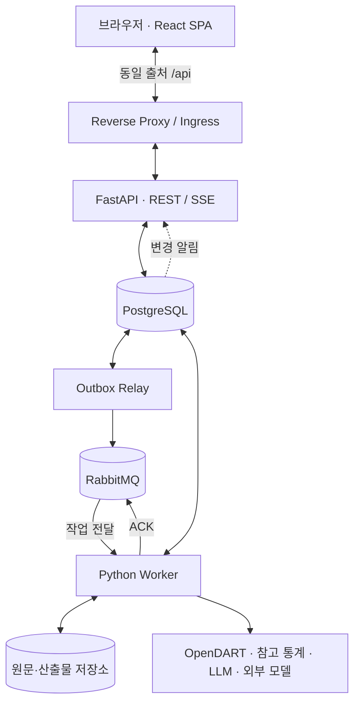

# LoanSight AI 전체 시스템 아키텍처

> v0.3 · 설계 초안 · 2026-10-27

이 문서는 시스템의 목적·구성·주요 결정과 상세 설계의 위치를 설명한다. 데이터 필드·API·상태 전이·배포 설정은 아래 주제별 문서에서 관리한다. 현재 저장소는 설계 단계이며 실행 가능한 애플리케이션 골격은 아직 없다.

## 목적과 범위

LoanSight AI는 OpenDART 재무정보·공시·주석을 기반으로 기업 여신 검토를 지원한다.

기업·보고서 선택 → 수집/직접 입력 → 정규화·재무 분석 → 주석 근거·현재 위험징후 → 외부 모델 추론 → 담당자 확인·검토 메모로 이어진다. 대상은 제조·건설·도소매·부동산 임대 4개 업종이다.

- 현재 위험징후는 규칙, 미래 12개월 복합 위험 사건 확률은 외부 모델, 최종 확인과 판단은 담당자가 맡는다.
- **AI 모델 학습은 이 저장소의 범위 밖이다.** 제공된 모델 파일/추론 API·입력 계약·검증 결과를 연동한다. 모델·입력 조건 미충족 시 확률을 보류한다.
- 여신 승인·거절, 은행 내부 신용등급 산정, 자산건전성 분류를 대신하지 않는다.
- 뉴스는 보완 기능이다. PDF 출력·지점 운영·추가 업종/기업 확대는 별도 확장 범위다.

## 시스템 구성

| 구성 요소 | 책임 |
|---|---|
| React SPA | 기업/보고서 선택·분석 화면·GNB 작업 상태·담당자 검토 UI |
| FastAPI | 요청·조회·접근 범위 검증·작업 등록·SSE 전달 |
| Worker | 수집·정규화·재무 계산·주석 추출·위험규칙·LLM/외부 모델 호출 |
| Outbox Relay / RabbitMQ | 접수한 작업의 발행·전달·확인·재전달 |
| PostgreSQL | 업무 데이터·입력/분석 버전·작업 상태·이벤트·검토 기록 |
| Storage Adapter | 공시 원본·큰 산출물·외부 모델 파일 보관 |

API·Worker·Relay는 같은 Backend 이미지의 실행 명령을 구분한다. Frontend는 별도 이미지로 제공한다. SaaS는 k3s를 지향하고 Self-hosted는 Docker Compose로 제공한다.

## 주요 기술 결정

| 주제 | 결정 및 방향 | 상태 |
|---|---|---|
| 제공 형태 | **SaaS 우선**, Self-hosted도 제공 | 채택 |
| 프론트엔드 | **React + Vite + TypeScript**, Next.js 미사용 | 채택 |
| 라우팅·UI | React Router, Tailwind CSS | 잠정 |
| 데이터 조회 캐시 | TanStack Query | 채택 |
| 백엔드 | **Python FastAPI** | 채택 |
| 분석 실행 | FastAPI와 동일 코드베이스의 **별도 Python Worker 프로세스** | 채택 |
| DB | PostgreSQL | 잠정 |
| 비동기 작업 | **RabbitMQ** 구독 기반 작업 전달, PostgreSQL에 작업 상태·결과 보관 | 채택 |
| 실시간 진행 알림 | **SSE**, 앱 공통 연결로 GNB와 상세 화면 갱신 | 채택 |
| 상태 변경 내부 알림 | PostgreSQL `LISTEN/NOTIFY`로 API에 알림, 영속 이벤트로 재생 | 잠정 |
| 작업 발행 일관성 | **Transactional Outbox**, publisher confirm 및 멱등 처리 | 채택 |
| LLM | **Codex SDK / 일반 LLM API 교체 가능한 Port & Adapter** | 채택 |
| 자체 ML 모델 | `modules/prediction`에서 사용, `integrations/ml`에 실행 어댑터 | 채택 |
| 원문 저장 | 로컬 파일/PVC; 확장 시 객체 스토리지로 전환 가능 | 잠정 |
| SaaS 배포 | k3s 중심 | 채택 방향 |
| Self-hosted 배포 | Docker Compose 기반 간편 설치 | 채택 |
| 사용자 식별 | **5자리 숫자 코드 + 서버 세션**, 정식 로그인은 후속 도입 | 초기 방식 채택 |
| PWA | HTTPS 및 기기별 설치 문제를 고려해 **후순위** | 보류 |
| Redis, 별도 API Gateway | 초기에는 도입하지 않음 | 잠정 제외 |
| MSA 분리 | 초기에는 채택하지 않음 | 제외 |

채택은 현재 개발 방향, 잠정은 구현 전 재검토 가능한 선택, 보류는 후속 결정 사항이다. 필드·경로·물리 스키마와 미정인 업무 수치를 구현 완료로 간주하지 않는다.

## 공통 원칙

- 원본을 보존하고 정규화·계산·요약 결과와 구분한다. 입력·원천·산식·규칙이 바뀌면 새 분석 버전을 만든다.
- 같은 분석 ID의 모든 화면은 같은 기준을 조회한다. 개인 입력·검토 데이터와 공개 공시의 공유 분석을 구분한다.
- 미확보·미검출·실패를 0이나 정상으로 바꾸지 않는다. 근거·단위·기준일·버전·보류 사유를 함께 제공한다.
- 작업 실행은 브라우저 연결과 독립적이다. 작업 전달은 MQ, 상태와 이벤트 보존은 DB, 화면 알림은 SSE가 담당한다.
- LLM·외부 모델이 없어도 가능한 재무 분석·원문·현재 위험징후를 제공한다.
- 초기에는 5자리 코드로 사용자를 구분하고 서버 세션으로 사용자별 GNB·SSE·검토 데이터를 분리한다. 내부 사용자 ID는 고정해 추후 정식 로그인과 연결한다. [초기 사용 범위·세션 계약](design/05_project-and-deployment.md#identity)을 따른다.

## 상세 설계 안내

| 알고 싶은 내용 | 담당 문서 |
|---|---|
| 업무 범위·직접 입력·재무/위험규칙·업종 비교·주석·논리 DB 모델 | [데이터·분석 설계](design/01_data-and-analysis.md) |
| REST API·분석 키/캐시·RabbitMQ·Outbox·SSE·재접속·GNB | [API·작업 처리 설계](design/02_api-and-jobs.md) |
| LLM 공급자 교체·4구역 요약·외부 모델 인수/추론·결과 보류 | [AI 연동 설계](design/03_ai-integration.md) |
| 공통 화면·출처 표시·원문 열람 후 체크·메모/초안 재생성 | [화면·검토 설계](design/04_ui-and-review.md) |
| 디렉터리·공통 이미지·Compose/k3s·식별/접근 범위·백업/관찰 | [프로젝트 구조·배포 설계](design/05_project-and-deployment.md) |
| 구현 순서·검수 기록·인수 기준·기능 41개 연결·미정 질문 | [개발·검증 계획](design/06_delivery-and-validation.md) |

각 상세 규칙은 담당 문서 한 곳에서 관리하고, 다른 문서에서는 링크로 참조한다. [커버리지 검토 기록](reviews/01_architecture-coverage-v0.3.md)은 요구와 설계의 연결을 확인하는 기록이다.

## 구현 시작점과 근거

실제 기업의 사업보고서 한 건을 수집 → 정규화 → 재무지표 → 주석 근거 → 규칙 판정 → 화면 조회까지 연결하는 수직 기능부터 구현한다. 상세 단계와 아직 결정할 정책은 [개발·검증 계획](design/06_delivery-and-validation.md#roadmap)을 따른다.

[기능 명세서 v0.0.4](https://github.com/loansight-ai/docs/blob/main/01-planning/functions.md)와 [화면설계서](<02_LoanSight AI_화면설계서_v0.0.2_261026.pdf>)를 참조한다. 외부 문서의 모델 개발 항목은 이 저장소의 구현 범위에 포함하지 않는다. PDF의 파일명/표지 버전 차이와 원본 해시는 검토 기록에 남긴다.
