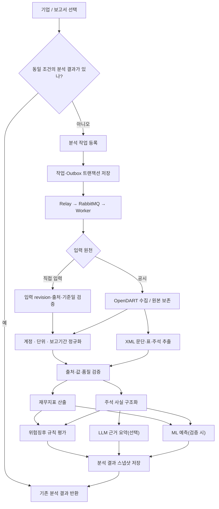

# LoanSight AI — 데이터·분석 설계

> v0.4 · 2026-10-28 · 설계 초안

이번 변경은 설계 목표의 개정이다. 실행 코드·DB 마이그레이션·실제 화면 구현 완료를 뜻하지 않는다.

[전체 아키텍처](../01_LoanSight_AI_Architecture_v0.4.md) / 입력·원천·정규화·재무/위험·비교·근거·논리 모델

## 업무 범위

업무 범위는 기획안 v2.2·요구사항 v0.0.6·PRD/기능명세서 v0.0.5·WBS v1.3에 연결한다. 상세 기획 원문은 별도 [docs 저장소](https://github.com/loansight-ai/docs)에서 관리하고, 이 문서는 구현 구조·데이터 계약·제공 조건을 정의한다.

| 영역 | 구현 범위·제한 |
|---|---|
| 대상 업종 | 제조·건설·도소매·부동산 임대 4개 업종 |
| 제외 업종 | 장비/물품 렌탈·운수/창고·금융/보험·지주/스팩·부동산 관리/중개 |
| 재무 분석 | 영업이익·현금흐름·차입/상환·운전자본 시각화, 실적 변동 기여도 분석 |
| 직접 입력·업종 변경 | 필수. 자동/수동 값 분리, 출처·기준일·변경자·사유·근거·revision 보존 및 변경 기준 재분석 |
| 주석 | 공통 주석 6항목과 업종별 사전 기반 추출·구조화·요약, 원문 구간·교차참조 보존 |
| 현재 위험징후 | 10개 판단 관점과 경고/주의/관찰을 표시하는 N-S04 패널. N-S04-1·04-2로 규칙 판정과 근거·요약을 구분 |
| 미래 사건 예측 | 외부 제공 모델을 연동해 추론하고 검증·입력 조건 충족 시 12개월 복합 사건 확률 표시. 모델 개발 방식·알고리즘은 이 저장소에서 지정하지 않음 |
| 검토 | 23개 RISK 후보의 자동/원문/외부 확인 분리, 경고 원문 열람 후 체크, 수정 문단 보존을 고려한 초안 재생성·복사·저장 |
| 업종 비교 | 필수. 자사 3개년·동일 기준 동종 분포/중앙값·한국은행 참고 평균, 패널 5개년 추세. 최소 비교 표본은 미정 |
| 뉴스·확장 | 뉴스는 보완 기능이며 초기 예측 모델 입력에서 제외. 추가 통계·업종/기업 확대·PDF 출력·지점 운영은 확장 범위 |

- 공통 주석 6항목은 **감사의견/계속기업, 차입 만기/재무약정, 신용등급, 담보, 소송/제재, 부외/후속사건**이다(N-F39).
- 판단 관점 10개는 **상환재원, 유동성/만기, 재무구조, 우발/부외 부담, 외부 평가, 담보/회수 여력, 수익성/원가구조, 운전자본/활동성, 성장의 질, 투자/자본효율성**이다(N-F36). 위험 단계의 수치 기준은 팀 가설이며 현직자 확인과 검증이 필요하다. 23개 RISK 후보 점검표의 상세 목록은 원자료 대조 전 예시로 채우지 않는다.
- 주석의 제공/수취·현재/전기·한도/잔액을 구분한다. 검출/공시상 없음/미검출/추출 실패를 구분하고, 미검출·금액 미기재를 0/없음으로 바꾸지 않는다.
- 요구 38개·기능 37개·화면 7개·미정 질문 18개, WBS v1.3의 현행 55개 작업을 구현·검수에 연결한다. N-S04의 세부 분할과 공통 GNB는 이 문서의 구현 관점 표현이며 기존 화면 수의 변경을 뜻하지 않는다.
- 예측 대상·버전·확률 제공 조건은 [AI 연동 설계](03_ai-integration.md#prediction)를 따른다. 규칙 단계·미래 모델 확률·담당자 체크는 별도로 관리한다.

## 수집·분석 흐름

직접 입력에 공시 원문이 없으면 주석·요약·예측의 해당 단계는 미확보/보류 사유를 기록하고 가능한 재무 결과를 제공한다. 원문 부재를 공시상 없음으로 바꾸지 않는다. 재무 결과는 확보된 범위에서 먼저 저장·조회 가능하게 하며 LLM/ML 지연·실패가 재무 조회를 막지 않게 단계별 가용 상태를 둔다.

## 수집 대상

| 목적 | 수집원/방법 | 원칙 |
|---|---|---|
| 기업 원장 | OpenDART 기업고유번호 목록 및 회사개황 | 로컬 캐시 후 갱신 |
| 공시 목록 | OpenDART 보고서 검색 | 신규·정정공시 확인 |
| 정형 재무제표 | OpenDART 재무정보 API | 별도(OFS) 기본, 연결(CFS)은 분리된 비교 자료 |
| 주석 및 상세 항목 | 사업보고서 원문 XML/ZIP | 문단·표·원문 위치 보존 |
| 직접 입력 | N-S01 필수 입력 UI·revision API | 조회 가능성 확인 후 자동 수집값과 분리, 출처·재무 기준일 필수, 충돌값 병기 |
| 비교 통계 | 한국은행 기업경영분석 공식 자료 | N-F08 기본 범위. 통계 연도·모집단·업종·원천 버전 보관, 수집/수입 방식·이용 조건 확인 후 적재 |

**원본 데이터는 수정하지 않고 보존한다.** 정정공시나 파서 버전 변경 시 기존 분석을 덮어쓰지 않고 새 분석 결과를 생성한다.

## 기업 선택·업종 판정·직접 입력

대응: N-F01/N-F04/N-F30, PDF 3쪽. 담당: company·financial·analysis.

| 데이터 | 논리 필드·규칙 |
|---|---|
| 기업 검색 결과 | 기업 식별자·corp_code(있는 경우)·회사명·종목코드·시장·DART 업종코드·서비스 업종·세부분류·결산월·대상/복합/미분류/제외·판정 이유·매핑 버전 |
| 업종 판정 | 가장 긴 접두 코드로 매핑하고 미분류는 유지한다. 복합은 부문 매출 근거를 연결하며 비중 문턱을 임의 확정하지 않는다. 제외 기업은 선택 불가다. |
| `industry_override` | 사용자/Workspace·기업·변경 전/후 업종·사유·원문/부문 매출 근거·변경자·일시·revision·매핑/업종 규칙 버전 |
| `manual_input_revision` | 사용자/Workspace·기업 참조·보고기간·재무 기준일·출처·계정/금액/통화/단위·회계 범위·입력자·생성 시각·이전 revision·스키마 버전 |

- 직접 입력은 공시 조회 가능성을 먼저 확인한 뒤 제공한다. 출처·재무 기준일 누락을 차단하고, 자동값과 수동값이 충돌하면 둘을 나란히 표시해 적용값의 근거를 남긴다. 자동 수집 원본을 수정하지 않는다.
- DART 공시가 없는 직접 입력은 접수번호를 만들어 넣지 않는다. 사용자 기업 참조와 입력 revision으로 분석을 식별하며 확인되지 않은 공시일·정보 가용 시각을 과거 예측의 기준으로 소급하지 않는다.
- 세부 입력 계정·필수 필드·분기 범위·변경 권한은 N-U02/08/15의 결정 사항이다. 구현 시 버전이 있는 입력 스키마로 검증하고 지원하지 않는 필드는 조용히 버리지 않는다.
- `POST /api/v1/me/manual-inputs`는 새 revision과 값별 충돌/검증 결과를 반환하고 `GET`은 본인의 입력 목록을 반환한다. 수정도 이전 값을 덮어쓰지 않고 새 revision으로 만든다.
- `POST /api/v1/me/industry-overrides`는 변경 사유·근거·권한을 검증하고 `GET`은 본인 범위의 변경 이력을 반환한다. 새 분석은 해당 override revision을 명시한다.
- `POST /api/v1/analyses`는 공시 원천 또는 직접 입력 revision, 적용 업종/override, 회계 범위, 리스 포함 등 계산 옵션을 받는다. 공시 기반 실행은 과거 자료 확보 범위도 기록한다. 입력·업종·옵션이 바뀌면 새 분석 키를 사용한다.
- 리스 포함 토글은 서버 계산 옵션으로 취급한다. 새 조건의 실행을 요청해 기존 결과를 재사용하거나 새 작업을 만들고, 프론트엔드에서 최종 지표를 재계산하지 않는다. 화면은 이전 조건과 새 조건의 결과를 혼합하지 않는다.

## 재무·산식·현재 위험징후

대응: N-F03/N-F05~07/N-F21/N-F31~34/N-F36~38, PDF 4·5·7·11쪽.

### 정규화와 재무 응답

- OFS 기본/CFS 별도 비교와 기준 차이, 기간·통화·단위·누적/당분기·정정 revision을 유지한다. 표준계정 ID→계정명 순으로 매핑하고 실제 0·결측·미확보·실패를 구분한다.
- 기능별/성격별 손익, 투자부동산 원가/공정가치, 임대료의 매출/기타수익, 리스 회계 차이를 `accounting_treatment`와 근거로 반환한다. 필수 계정 확보 점검과 같은 계정 사전 버전을 사용한다. 회계식 허용오차는 미정이다.
- `GET /analyses/{id}/financials`는 지표별 값·단위·당기/전기·변화·자료 상태·사유·산식/계정 버전·입력 사실/근거 ID를 반환한다. 산식 팝오버에는 분자·분모·기말/연평균·표시 정밀도·근사 여부/이유를 포함한다.
- 공통 핵심은 유동비율·부채비율·매출액영업이익률·총자산영업이익률·이자보상비율이며 유동성·레버리지·활동성·수익성·성장성 묶음으로 표시한다. 영업이익을 우선 배치하고 감가상각의 업종별 강조와 EBITDA 상각 중복을 점검한다.
- 총차입금은 단기·유동성장기·장기차입·사채를 구분한다. 차입금의존도·단기차입 비중·이자보상·EBITDA 이자보상·현금보상·금융비용부담률과 리스 포함 옵션을 함께 표시한다. 임대보증금은 별도 부채로 표시하고 실질 차입 포함 여부는 미정으로 유지한다.
- 재고/채권/채무 회전일수·현금전환주기·전기 대비 변화, 건설 계약자산/계약부채 증감을 제공한다. 매출원가 미확보는 회전일수의 계산 불가 사유로 남긴다.
- 분모 0·음수·흑적 전환·첫해 자료 없음은 지표별 산식 정책으로 금액 차이·상태·계산 불가를 구분한다. 회계상 유효한 음수 금액까지 일괄 계산 불가로 처리하지 않는다. 금융원가 근사 허용, 기말/연평균 및 첫해 정책은 미정이며 미승인 근사를 확정값으로 표시하지 않는다.
- OP 변동 분해는 매출 증감−원가 증감−판관비 증감이고 실제 OP 증감과의 차이는 기타·조정 잔차로 반환한다. 원가 미공시 성격별 손익은 분해 불가, 기타수익 임대료 등은 분해 불완전 사유를 표시한다. 회계 분해를 사업상 원인으로 단정하지 않는다.
- OP/OCF 차이와 상각·채권·계약자산·재고·채무·이자/법인세 항목을 제공한다. 단기차입의 장기부채 상환·과다 배당 등은 확인 항목으로 연결하고 공시만으로 자금 용도를 단정하지 않는다.

### 판단 축·우선 지표·규칙

판단 축은 **상환재원, 유동성/만기, 재무구조, 우발/부외 부담, 외부 평가, 담보/회수 여력, 수익성/원가구조, 운전자본/활동성, 성장의 질, 투자/자본효율성**이다. 규칙은 ID·버전·적용 업종·축·조건·기간·임계값 출처(팀 가설/공식 통계/현직자 확인)·입력/근거·단계·결측 사유·표시 우선순위를 가진다.

| 업종 | N-F36 우선 5개 지표 |
|---|---|
| 제조 | CCC, 재고/채권 증가율−매출증가율, 영업CF/영업이익, CAPEX/영업CF, 이자보상 |
| 도소매 | 매출총이익률 변화, 재고회전율, 매입채무일수 변화, CCC, 리스 포함 부채비율 |
| 건설 | 계약자산−매출 증가율, 공사미수금 회수기간, 원가율, PF/조건부 의무 대비 자본 및 1년 내 PF 비중, 영업CF/유동부채 |
| 부동산 임대 | EBITDA 이자보상, 차입/투자부동산, 1년 내 만기 차입 비중, 현금보상, 평균 조달금리 |

- 공통 지표는 영업이익률·영업CF/영업이익·이자보상·자본잠식이다. 보조/왜곡 항목과 이유를 따로 표시한다. 업종 기준으로 대체한 공통 규칙도 숨기지 않고 낮춘 이유를 보존한다.
- `GET /analyses/{id}/signals`는 경고/주의/관찰별 건수·목록·10개 관점 필터·규칙 버전·근거·연결 review 항목과 N-F38 패널 데이터를 제공한다. 단계 없음·미평가·입력 부족을 정상 등급으로 만들지 않는다.
- 경고는 상단 고정·원문 확인, 주의는 확인 목록, 관찰은 추세·업종 위치로 연결한다. 조건 조항 존재와 실제 사유 발생을 구분하고 자동 제안을 담당자 확인 완료로 바꾸지 않는다. 수치/기간·복수 규칙 우선순위·결측 시 단계는 N-U12/17을 따른다.
- N-F34의 23개 RISK 후보은 자동 판정/주석·원문 확인/외부 확인으로 매핑하고 `review-context`로 반환한다. 상세 목록과 판정 기준은 원자료 대조 후 확정하며 10개 판단 관점이나 예시 규칙만으로 23개를 임의 구성하지 않는다.

## 업종 비교·기간별 차트

대응: N-F08/N-F28/N-F38, PDF 4·7쪽. 담당: benchmark·financial·integrations/statistics.

- 자사 비교는 3개년, N-S04 위험 패널 추세는 5개년이다. 필요한 과거 보고서와 정정 revision을 확보하고 각 연도의 기간·회계 범위·원천·자료 상태를 기록한다. 확보하지 못한 연도를 0으로 채우지 않는다.
- 동종 비교는 같은 기간·회계 기준 상장사 분포·중앙값·자사 위치다. 비교 스냅샷은 구성 기업/버전·세부분류·상위 분류 전환 이유·표본 수·수집 범위·지표/산식 버전·비교 가능 상태를 가진다.
- 세부분류 표본 부족→상위 분류→계속 부족하면 비교 보류를 적용한다. 미정인 최소 표본 정책 자체가 아직 설정되지 않았다면 임의의 수를 적용하지 않고 정책 미설정 상태를 반환한다.
- 한국은행 기업경영분석은 공식 원천 Adapter로 수집하거나 버전 있는 공식 자료를 수입한다. URL/파일 해시·이용 조건 확인·연도·모집단·산업분류·단위·지표 정의·원천 revision을 보관한다. 실제 수집 방식과 통계 범위·연도 시차는 N-U16에서 확정한다. ECOS 등 특정 API 사용을 미리 확정하지 않는다.
- 한국은행 평균은 상장사 동종 중앙값과 다른 참고 계열이다. 조회 실패·미확보는 별도로 표시하고 상장사 표본과 섞거나 다른 연도의 값으로 조용히 대체하지 않는다. 실제 확보는 구현 후 검증한다.
- `GET /analyses/{id}/benchmarks`는 자사 추세·동종 분포/중앙값·참고 통계 각각의 값/상태·기간·회계 범위·분류·표본·출처/버전과 비교 보류 이유를 반환한다. 분석 실행이 참조하는 비교 스냅샷을 고정한다.
- 차트 계열은 기간/만기 bucket·값·단위·당기/전기·상태·근거·옵션·표본/산식 버전을 가진다. 패널은 5개년 스파크라인·불릿·점 플롯과 업종별 교체 차트를 사용하며 게이지/레이더는 사용하지 않는다.
- 제조는 CCC 분해·증가율·OP/OCF/CAPEX, 도소매는 매출총이익률(%p)·채무/재고일수·리스 포함/제외 부채비율, 건설은 PF 만기·계약자산/매출·우발/자본·원가율, 임대는 차입 만기/평균 금리·EBITDA 이자보상·차입/투자부동산·임대율을 연결한다.
- PF 만기는 3·6·12개월/1~2년/2~3년/3년 초과 구간을 중복 없이 구성한다. 정비/기타와 한도/보증금액/대출잔액을 구분하고 1년 내 합계·비중의 분모/기준일을 보존한다. 계약상 만기와 공시 기준일, 화면 관찰 시점의 차이를 설명한다. 팀 가설선은 승인 기준으로 표현하지 않는다.

## 원문·주석 추출·검수

대응: N-F02/N-F09~11/N-F39~41, PDF 6쪽. 담당: disclosure·evidence·validation·LLM Adapter.

사업보고서를 I.1 신용등급, II 사업, III 주석, IV.4 유동성/조달, IV.5 부외거래, V.1 외부감사, XI.2~4 우발/제재/후속사건 등 목차 단위로 인덱싱한다. 제목부터 다음 번호/소제목 전까지 후보를 추출하고 다른 장 참조를 따라간다.

| 논리 데이터 | 필수 연결 |
|---|---|
| `source_segment` | 아티팩트 ID/해시·접수번호·목차 경로·주석 번호/제목·문단/표/셀 위치·발췌·하이라이트 범위·참조 대상/실패·파서 버전 |
| `note_evidence` | 기업·공시/재무 기준일·항목 유형·방향(제공/수취, 원고/피고)·당기/전기·금액/통화/단위·한도/보증금액/실행잔액·만기·상대방/특수관계·계류/종결·추출 방식·source_segment ID·사전/추출 revision |
| `evidence_verification` | 근거 revision·검수 상태(대기/검증/반려 등)·자동/수동 검증 방식·검증자/도구·시각·원문 대조·사유·검증 정책 버전 |

공통 6항목은 **감사의견/계속기업, 차입 만기/재무약정, 신용등급, 담보, 소송/제재, 부외/후속사건**이다. 회사채/CP/전단채 등 평가 대상을 구분하고 당기 의견과 전기 비교를 분리한다.

업종별 사전은 제조의 재고/충당금·손상/개발비/공급자금융·가동률/연구개발, 도소매의 리스/공급자금융·매입처/점포, 건설의 PF/신용보강/조건부 의무·계약자산/추정원가·수주/분양률/미분양, 임대의 약정/담보/보증/소송·만기/금리·투자부동산 평가·임대율/공실/임차인/보증금을 포함한다. 세부 검색어·참조 우선순위·미검출 보완 범위는 N-U18에서 버전화한다.

- 검출 상태는 DETECTED/EXPLICITLY_NONE/NOT_DETECTED/FAILED다. 검출 상태와 검수 승인 상태를 분리한다. 공시상 없음은 원문 명시 때만 인정하고 금액 미기재·미검출·파싱 실패를 0으로 바꾸지 않는다.
- 제공/수취와 원고/피고·당기/전기·계류/종결을 구분한다. PF 총괄/하위표 중복, 한도/금액/잔액 중복을 막고 우발→충당 전환은 별도 사실로 유지한다. 일반 담보·차입약정·리스를 우발채무로 자동 확정하지 않는다. 채권 연령분석의 연체를 회사 차입 연체 사건으로 해석하지 않는다.
- `GET /analyses/{id}/evidences`는 항목별 검출/검수 상태·건수·금액 역할·근거·제공/수취 분리 합계·만기/소송 타임라인을 제공한다. 탐색 실패·순환 참조·단위/부정 표현의 불확실성을 보존한다.
- `GET /analyses/{id}/source-segments/{segmentId}`는 허용된 분석의 원문 구간·하이라이트·목차/접수번호·교차참조 대상과 그 해석 상태를 반환한다. 뷰어 렌더링용 원문은 스크립트 등 실행 콘텐츠를 제거하되 보관 원본 해시는 유지한다.

검증된 근거의 요약 계약은 [AI 연동 설계](03_ai-integration.md#summary)를 따른다.

## 공통 데이터 상태

다음 상태는 프론트엔드와 백엔드가 동일한 의미로 취급한다.

| 구분 | 상태 예시 | 의미 |
|---|---|---|
| 재무값 | `CONFIRMED`, `APPROXIMATE`, `MISSING`, `NOT_COMPUTABLE` | 확정, 근사, 미확보, 계산 불가 |
| 주석 | `DETECTED`, `EXPLICITLY_NONE`, `NOT_DETECTED`, `FAILED` | 검출, 원문에 없음 명시, 미검출, 추출 실패 |
| 모델 연동 | `UNREGISTERED`, `UNVERIFIED`, `VALIDATED`, `WITHHELD` | 미등록, 검증 근거 부족, 외부 검증 근거 확인, 표시 보류 |
| 검토 | `PENDING`, `CONFIRMED` | 미확인, 담당자 확인 완료 |
| 작업 | `QUEUED`, `RUNNING`, `RETRY_WAIT`, `SUCCEEDED`, `PARTIAL_SUCCEEDED`, `FAILED` | 대기, 실행, 재시도 대기, 완료, 일부 완료, 실패 |

누락값을 0으로 대체하지 않는다. `NOT_DETECTED`와 `EXPLICITLY_NONE`은 구분한다. 현재 위험징후 단계와 미래 사건 확률도 혼동하지 않는다.

## 논리 데이터 모델

정확한 컬럼과 FK는 실제 구현 전에 확정한다.

각 기록에는 관련 분석 ID·원천/소유 범위·revision·생성/가용 시각과 적용한 계정/산식/사전/규칙/모델 버전을 연결한다. 공개 공시 기반의 공통 분석과 개인 입력·override가 반영된 결과의 공유 범위를 구분한다.

| 테이블(안) | 역할 |
|---|---|
| `app_user` | 불변 user_id, 유일한 5자리 user_code 문자열, 활성 상태·생성 시각 |
| `workspace` | 기본 작업공간과 owner_user_id. 초기에는 사용자당 하나 |
| `user_session` | 세션 토큰 해시·사용자/Workspace·만료/폐기 상태. 상세 규칙은 [사용자 식별](05_project-and-deployment.md#identity) 참조 |
| `company` | 기업고유번호, 기업명, 시장, 업종 |
| `disclosure` | 접수번호, 보고서 종류, 사업연도, 접수일, 정정 관계 |
| `source_artifact` | 원문 파일 위치, 해시, 수집 시각 |
| `financial_fact` | 재무 계정, 회계 범위, 기간, 정규화 금액, 출처 |
| `note_evidence` | 추출 항목, 원문 위치, 검출 상태, 추출 버전 |
| `obligation` | 차입금, 지급보증, 만기, 담보 등 구조화 결과 |
| `analysis_run` | 특정 입력 및 분석 버전으로 수행한 실행·스냅샷 |
| `analysis_job` | 작업 종류(분석/초안 재생성)·분석/검토 참조·상태/단계, attempt, heartbeat, 실행 임대·소유권, 재시도 시각·오류 |
| `outbox_message` | 작업과 함께 저장하는 발행 요청, 고유 message_id, 발행 확인·재시도 |
| `user_analysis_task` | 사용자·Workspace와 공유 분석의 연결, 최근 확인 시각·확인한 완료 버전 |
| `task_event` | 수신 사용자·Workspace별 영속 이벤트, 스트림 순번, 작업·분석 ID와 상태 버전 |
| `metric_result` | 계산 지표, 상태, 산식 버전 및 근거 |
| `risk_signal` | 규칙 ID/버전, 판정 단계, 근거 |
| `prediction_result` | 모델·특징·사건 정의 버전, 기준일·12개월 예측 기간, 확률 또는 미제공 상태·사유, 검증 상태 |
| `review_item`, `review_draft` | 사용자/Workspace·분석에 속한 체크리스트와 검토 메모 |
| `audit_event` | 분석 조건·수동 변경·검토 내용의 변경 기록 |

기능 명세를 충족하기 위해 다음 논리 데이터를 추가한다. 구현 시 저장 단위를 합칠 수 있으며 모든 개념을 독립 테이블로 강제하지 않는다.

| 논리 모델 | 주요 연결·보존 내용 |
|---|---|
| `manual_input_revision`, `industry_override` | 사용자/Workspace·출처·재무 기준일·계정값·업종 변경 전후·사유·근거·변경자·revision |
| `formula_definition`, `account_mapping`, `rule_definition` | 산식/계정·회계처리 차이·근사 정책·잔액 기준·판단 축·출처 종류·업종 대체 이유·버전 |
| `benchmark_snapshot`, `statistic_series` | 비교군/구성 기준·분류 fallback·기간·표본·통계 모집단/연도·원천 버전 |
| `source_segment`, `evidence_verification` | 아티팩트 해시·목차/문단/표/셀 위치·교차참조·추출/검수 revision·검출/검수 상태 분리 |
| `feature_snapshot` | 실제 추론 입력값·원천/가용 시각·특징/전처리 버전·품질 상태 |
| `model_manifest`, `prediction_explanation` | 외부 제공 모델/입력 계약·파일 해시·사용 가능/보류 상태·원문 근거·영향 값/단위 |
| `evidence_view`, `review_draft_revision` | 사용자·분석·경고·근거 revision별 열람, 문단별 생성/수정·담당자 의견·기반 revision |

입력·재무·근거 필드는 이 문서에서 정의한다. 모델 필드는 [AI 연동 설계](03_ai-integration.md#prediction), 검토 상태는 [화면·검토 설계](04_ui-and-review.md#review)를 따른다. 필드명·HTTP 경로는 구현 계약 초안이며 물리 컬럼·FK는 마이그레이션 설계 시 확정한다.

## 데이터 정확성 원칙

- 원본과 정규화·계산·요약 데이터를 계층별로 구분한다.
- 계산식·데이터 출처·산식 버전을 API로 노출할 수 있도록 한다.
- 근사값은 이유와 함께 표시하고, 미확보/계산 불가를 0이나 정상으로 간주하지 않는다.
- 회계상 증감 분해를 실제 사업상 원인으로 단정하지 않는다.
- 주석 보증한도·보증금액·실제 대출잔액, 보증 제공·수취를 구분하고 중복 합산하지 않는다.

## v2.1 보완 연결

11개 보완 산식과 업종별 정의는 [기능명세 상세](https://github.com/loansight-ai/docs/blob/main/01-planning/functions.md)를 따른다. 분모 0/음수·첫해·OFS/CFS·추세와 회계 차이는 기존 상태 계약을 유지한다.

개별 이벤트와 7유형 복합 위험을 분리하고, 값·기간·조건 조합·근거·자료 부족을 반환한다. `signals`의 패널 계열에는 이벤트 타임라인과 연도×위험영역 매트릭스를 포함하며 미확보 기간을 정상으로 표시하지 않는다.

N-F42는 정량 징후 → 관련 주석 → 원인 후보 → 원문 근거 → 담당자 질문/자료 요청을 연결한다. 재무비율은 코드가 계산하고 AI는 원문 분류·요약·설명 후보만 만든다. 원인 후보를 인과관계로 확정하지 않는다.

P0 핵심 계산·정량 징후·원문/단위/연도, P1 복합 위험·주석 연결·타임라인/매트릭스, P2 PF/공사별 세부 자료·임계값 보완 순서다. 임계값은 초기 후보로 유지한다.

## 개정 이력

| 버전 | 개정일 | 변경 |
|---|---|---|
| v0.3 | 2026.10.27 | 이전 설계 기준, Git 이력 보존 |
| v0.4 | 2026.10.28 | 최신 기획 연결·내부 관리 분리·기존 동작 계약 보존 |
