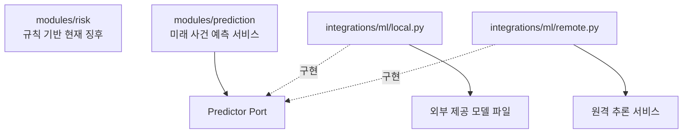
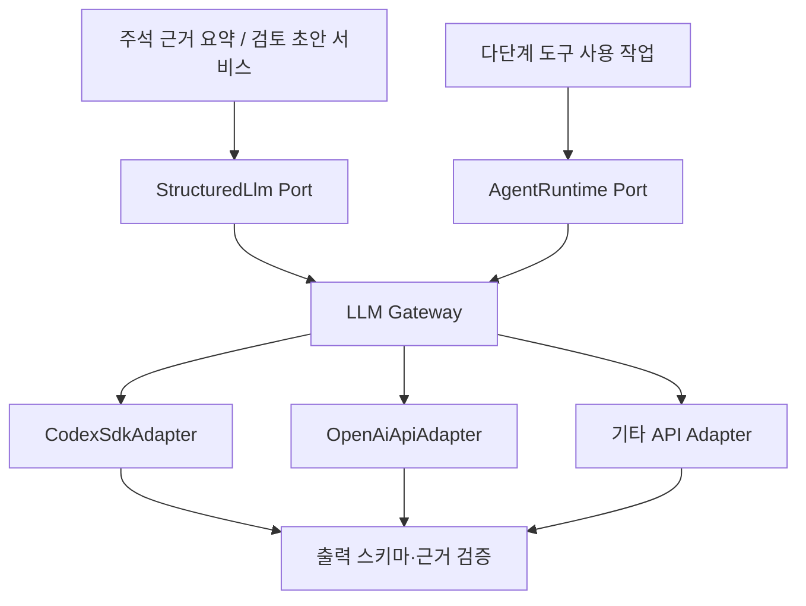

# LoanSight AI — AI 연동 설계

> v0.3 · 2026-10-27 · 설계 초안

[전체 아키텍처](../01_LoanSight_AI_Architecture_v0.3.md) / LLM 요약·외부 모델 인수·추론·검증 결과 표시. 모델 학습은 저장소 범위 밖이다.

<a id="boundaries"></a>

## 위험규칙과 외부 모델의 책임

| 대상 | 책임 | 위치 |
|---|---|---|
| 현재 위험징후 판정 | 재무비율·주석 사실을 규칙과 대조하여 경고/주의/관찰 등 산출 | `modules/risk` |
| 미래 위험 사건 예측 | 지정된 모델·특징 버전으로 추론 요청, 검증 여부 판단, 결과 저장 | `modules/prediction` |
| 로컬 자체 모델 실행 | 모델 로딩, 전처리 입출력 변환, 추론 | `integrations/ml/local.py` |
| 외부 모델 서버 실행 | HTTP/gRPC 등 호출, 타임아웃, 결과 변환 | `integrations/ml/remote.py` |



**판단:** 자체 모델이 외부 서비스가 아니라 Python 프로세스 내에서 실행되더라도, `integrations/ml`에 추론 어댑터를 두는 구조를 사용한다. `risk`에 모델 종속 코드를 직접 넣지 않는다.

<a id="prediction"></a>

## 외부 모델 인수·추론·예측 응답

대응: N-F15의 런타임 입력 구성, N-F19의 외부 검증 결과 표시, N-F20 및 PDF 9·10쪽. 담당: prediction·integrations/ml, 보고서 조회: validation. 모델 개발 항목은 외부 의존성으로 관리한다.

### 외부 제공물과 런타임 기록

| 논리 데이터 | 내용 |
|---|---|
| `model_manifest` | 제공자·모델 ID/버전·파일 해시 또는 endpoint·입력 스키마/특징/전처리 버전·필수 입력/단위/결측 정책·대상 정의/기간·사용 가능 상태 |
| `model_validation_report` | 외부 보고서 ID/버전/출처·대응 모델/대상·검증 상태·승인 근거·제공된 표본/지표/비교 결과·비교 가능 조건/한계 |
| `feature_snapshot` | 실제 추론 입력·financial_as_of·prediction_as_of·각 원천 available_at·계정/산식/근거 검수 버전·입력 품질·특징/전처리 버전 |
| `prediction_result` | 사용 모델/manifest·보고서 참조·입력 해시·출력/보류/오류·추론 시각·설명 결과/방법/단위 |

대표 목표는 **기준 공시일 이후 12개월 복합 위험 사건**이다. 대상 사건과 포함/제외·기간 경계·정의 버전은 제공 모델 명세로 확인한다. 대상이 다르거나 명세가 없으면 같은 목표의 확률처럼 표시하지 않는다. 공시 기반 확률을 실제 은행 대출 연체율로 표현하지 않는다.

- 외부 모델은 로컬 파일과 추론용 변환 산출물 또는 원격 API로 제공받는다. 알고리즘·모델 구성은 제공물의 메타데이터를 표시하며 이 저장소에서 지정하지 않는다.
- 제공 스키마에 맞게 검증된 재무/주석을 입력으로 구성하고 시각·단위·결측·버전 호환성을 검사한다. 제공된 변환만 실행하며 전처리 파라미터의 재적합이나 확률 보정값 조정은 하지 않는다.
- 모델/특징/전처리/대상 버전에 맞는 외부 검증 보고서와 사용 가능 상태를 연결한다. 보고서를 제공받지 못했거나 검증 근거가 부족하면 확률을 보류한다. 보고서 수입을 이 저장소의 자체 검증 완료로 기록하지 않는다.
- 원격 타임아웃/오류·모델 파일 미등록·입력 부족·시점 부적합·버전 불일치는 사유와 함께 기록한다. 직접 입력의 과거 가용 시각이 검증되지 않으면 시점 적합성을 충족한 것으로 처리하지 않는다. LLM과 뉴스는 확률 계산에 사용하지 않는다.

### `GET /analyses/{id}/prediction`

| 응답 영역 | 필드·표시 원칙 |
|---|---|
| 목표·기간 | target_definition/version, financial_as_of, prediction_as_of, horizon_start/end, 모델/특징 버전 |
| 모델별 결과 | 제공된 baseline/combined 각각 probability 또는 null, external_validation_status, serving_status, withholding_reasons, input_quality. 미제공 모델은 미등록 상태 |
| 외부 검증 요약 | validation_report_id/출처/버전, 제공된 평가셋 ID·사건 비율·PR-AUC/Brier 등 지표·비교 가능 조건·한계. 미제공 값은 null |
| 설명 | 실제 입력값/상태·근거 ID·제공된 signed influence·방법/단위/버전·설명 가능/미지원/실패 상태 |
| 추가 확인 | 공시로 확인 불가한 내부 자료 항목·N-S07 참조·현재 징후/담당자 확인 상태 |

- 외부 검증 상태와 개별 추론 제공 상태를 분리한다. 조건 미충족 시 해당 확률은 null이며 구체 사유를 반환한다. 한 모델의 출력이 없으면 다른 모델 값을 대신 넣지 않는다.
- 비교 지표·사건 비율·보정 결과는 외부 보고서에서 제공된 값을 그대로 출처와 함께 표시한다. 이 저장소에서 성능 평가나 지표 산출을 수행하지 않는다. 대상/기간/평가셋 조건이 다른 결과를 동일 비교로 표시하지 않는다.
- 변수 영향은 제공된 설명 결과 또는 설명 가능한 추론 Adapter에서 가져온다. 방법·단위·미지원/실패 상태를 표시하고 LLM이 숫자를 만들지 않는다. 영향 값은 인과나 확률의 %p가 아니다. 설명 미지원 시 확률 제공 여부는 인수 정책에서 확정한다.

<a id="llm"></a>

## LLM Port & Adapter

Codex SDK와 일반 LLM API는 실행 능력이 다르므로, **공통 생성 인터페이스**와 **에이전트 실행 인터페이스**를 분리한다.



<a id="llm-rules"></a>

## LLM 공통 규칙

- 비즈니스 모듈은 공급자 SDK를 직접 참조하지 않는다.
- 기능별로 공급자를 선택할 수 있다(예: 주석 요약, 검토 초안).
- LLM에 제공하는 수치는 **검증된 계산 결과**를 사용한다.
- 구조화 응답은 Pydantic으로 검증한다.
- 원문에 없는 사실, 금액, 출처가 생성되지 않았는지 별도 검증한다.
- 프롬프트·모델·공급자·출력 스키마·생성 설정의 버전을 기록한다.
- 같은 조건의 결과는 재사용한다.
- 공급자 미설정 또는 실패 시 핵심 재무 분석과 위험규칙은 독립적으로 동작한다.

<a id="summary"></a>

## 근거 검수와 4구역 요약

- 요약·모델에 전달하는 근거는 승인된 검증 정책을 충족한 해당 revision으로 한정한다. 검출됐다는 이유만으로 사용하지 않는다. 검증 방법·승인자·문턱이 미설정이면 미검증 상태로 남긴다.
- `note_hierarchy`의 계층·표 연결·구조 검증 결과를 승인된 사실로 직접 전달하지 않는다. 원천 위치 연결과 후속 검색 입력 구성은 [주석 구조화 경계](01_data-and-analysis.md#note-hierarchy)를 따르며, 사실 추출·검수 후 해당 근거 revision을 입력한다.
- 요약은 **확인된 사실 / 원문 근거 / 해석과 한계 / 담당자 추가 확인** 4구역으로 구조화한다. 계산값·원문만 인용하고 회사 주장/확인 사실, 검색 없음/명시적 없음, 조건 존재/실제 발생을 구분한다.
- 생성 결과에는 입력 근거/계산값 해시·공급자/모델/프롬프트/스키마 버전·검증 상태·사용한 근거 ID를 연결한다. 소송 결과·손실·내부 약정·담보 평가를 추정으로 확정하지 않는다. LLM 실패 시 원문·재무·규칙을 계속 제공한다.

<a id="configuration"></a>

## 공급자 설정·인증

```yaml
llm:
  tasks:
    note_summary: codex
    review_draft: api
  providers:
    codex:
      sandbox: read_only
    api:
      model: configured-model
```

이는 설정 형식의 예시이며 실제 라이브러리의 설정 스키마가 아니다. Codex는 설치 서버에서 별도로 인증한다. SaaS에서 **각 사용자별 Codex 구독 인증을 어떤 방식으로 지원할지**는 아직 결정하지 않는다. API 키와 인증정보는 코드나 배포 이미지에 포함하지 않는다.
