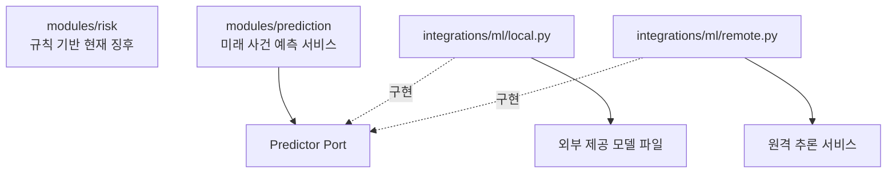
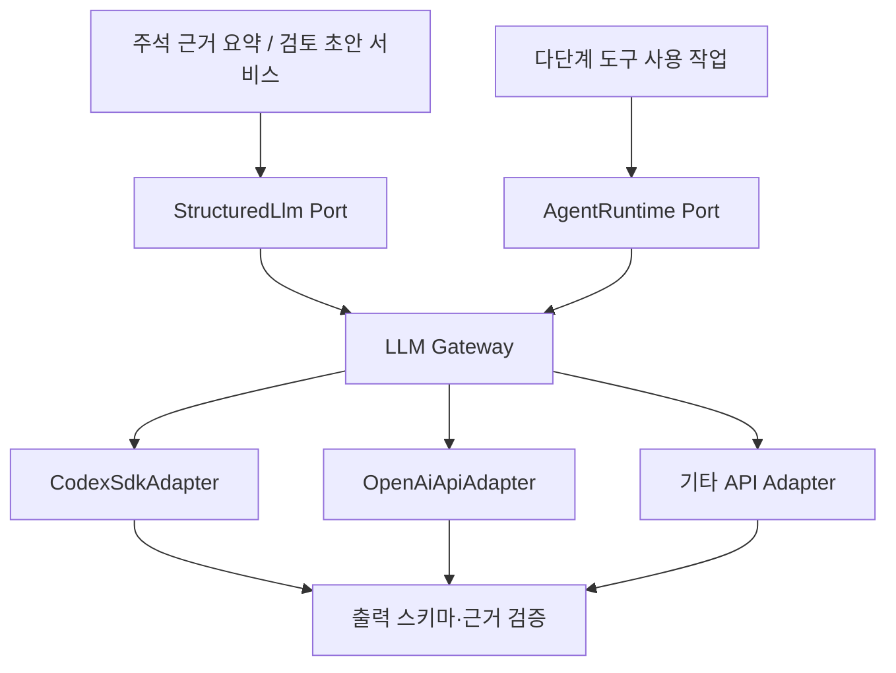

# LoanSight AI — AI 연동 설계

> v0.4 · 2026-10-28 · 설계 초안

이번 변경은 설계 목표의 개정이다. 실행 코드·DB 마이그레이션·실제 화면 구현 완료를 뜻하지 않는다.

[전체 아키텍처](../01_LoanSight_AI_Architecture_v0.4.md) / LLM 요약·외부 모델 인수·추론·제공 가능/보류 상태 표시. 모델 학습은 저장소 범위 밖이다.

<a id="boundaries"></a>

## 위험규칙과 외부 모델의 책임

| 대상 | 책임 | 위치 |
|---|---|---|
| 현재 위험징후 판정 | 재무비율·주석 사실을 규칙과 대조하여 경고/주의/관찰 등 산출 | `modules/risk` |
| 미래 위험 사건 예측 | 지정된 모델·특징 버전으로 추론 요청, 검증 여부 판단, 결과 저장 | `modules/prediction` |
| 로컬 자체 모델 실행 | 모델 로딩, 전처리 입출력 변환, 추론 | `integrations/ml/local.py` |
| 외부 모델 서버 실행 | HTTP/gRPC 등 호출, 타임아웃, 결과 변환 | `integrations/ml/remote.py` |



**판단:** 자체 모델이 외부 서비스가 아니라 Python 프로세스 내에서 실행되더라도, `integrations/ml`에 추론 어댑터를 두는 구조를 사용한다. `risk`에 모델 종속 코드를 직접 넣지 않는다.

<a id="prediction"></a>

## 외부 모델 인수·추론·예측 응답

대응: N-F15의 런타임 입력 구성과 N-F20의 결과/보류 표시. 담당: prediction·integrations/ml. 모델 개발은 외부 의존성이다.

### 외부 제공물과 런타임 기록

| 논리 데이터 | 내용 |
|---|---|
| `model_manifest` | 제공자·모델 ID/버전·파일 해시 또는 endpoint·입력 스키마/특징/전처리 버전·필수 입력/단위/결측 정책·대상 정의/기간·사용 가능 상태 |
| `feature_snapshot` | 실제 추론 입력·financial_as_of·prediction_as_of·각 원천 available_at·계정/산식/근거 검수 버전·입력 품질·특징/전처리 버전 |
| `prediction_result` | 사용 모델/manifest·제공 상태·입력 해시·출력/보류/오류·추론 시각·설명 결과/방법/단위 |

대표 목표는 **기준 공시일 이후 12개월 복합 위험 사건**이다. 대상 사건과 포함/제외·기간 경계·정의 버전은 제공 모델 명세로 확인한다. 대상이 다르거나 명세가 없으면 같은 목표의 확률처럼 표시하지 않는다. 공시 기반 확률을 실제 은행 대출 연체율로 표현하지 않는다.

- 외부 모델은 로컬 파일과 추론용 변환 산출물 또는 원격 API로 제공받는다. 알고리즘·모델 구성은 제공물의 메타데이터를 표시하며 이 저장소에서 지정하지 않는다.
- 제공 스키마에 맞게 검증된 재무/주석을 입력으로 구성하고 시각·단위·결측·버전 호환성을 검사한다. 제공된 변환만 실행하며 전처리 파라미터의 재적합이나 확률 보정값 조정은 하지 않는다.
- 모델/특징/전처리/대상 버전과 제공 가능 상태를 연결한다. 제공 조건이 없거나 자료가 부족하면 확률을 보류한다.
- 원격 타임아웃/오류·모델 파일 미등록·입력 부족·시점 부적합·버전 불일치는 사유와 함께 기록한다. 직접 입력의 과거 가용 시각이 검증되지 않으면 시점 적합성을 충족한 것으로 처리하지 않는다. LLM과 뉴스는 확률 계산에 사용하지 않는다.

### `GET /analyses/{id}/prediction`

| 응답 영역 | 필드·표시 원칙 |
|---|---|
| 목표·기간 | target_definition/version, financial_as_of, prediction_as_of, horizon_start/end, 모델/특징 버전 |
| 모델별 결과 | 제공된 baseline/combined 각각 probability 또는 null, serving_status, withholding_reasons, input_quality. 미제공 모델은 미등록 상태 |
| 설명 | 실제 입력값/상태·근거 ID·제공된 signed influence·방법/단위/버전·설명 가능/미지원/실패 상태 |
| 추가 확인 | 공시로 확인 불가한 내부 자료 항목·N-S07 참조·현재 징후/담당자 확인 상태 |

- 모델 등록 상태와 개별 추론 제공 상태를 분리한다. 조건 미충족 시 해당 확률은 null이며 구체 사유를 반환한다. 한 모델의 출력이 없으면 다른 모델 값을 대신 넣지 않는다.
- 변수 영향은 제공된 설명 결과 또는 설명 가능한 추론 Adapter에서 가져온다. 방법·단위·미지원/실패 상태를 표시하고 LLM이 숫자를 만들지 않는다. 영향 값은 인과나 확률의 %p가 아니다. 설명 미지원 시 확률 제공 여부는 인수 정책에서 확정한다.

<a id="llm"></a>

## LLM Port & Adapter

Codex SDK와 일반 LLM API는 실행 능력이 다르므로, **공통 생성 인터페이스**와 **에이전트 실행 인터페이스**를 분리한다.



<a id="llm-rules"></a>

## LLM 공통 규칙

- 비즈니스 모듈은 공급자 SDK를 직접 참조하지 않는다.
- 기능별로 공급자를 선택할 수 있다(예: 주석 요약, 검토 초안).
- LLM에 제공하는 수치는 **검증된 계산 결과**를 사용한다.
- 구조화 응답은 Pydantic으로 검증한다.
- 원문에 없는 사실, 금액, 출처가 생성되지 않았는지 별도 검증한다.
- 프롬프트·모델·공급자·출력 스키마·생성 설정의 버전을 기록한다.
- 같은 조건의 결과는 재사용한다.
- 공급자 미설정 또는 실패 시 핵심 재무 분석과 위험규칙은 독립적으로 동작한다.

<a id="evidence-search"></a>

## 키워드 도구를 사용하는 근거 탐색 설계

2026-10-28 설계 방향: 기존 PostgreSQL·FastAPI·SQLAlchemy와 외부 LLM의 도구 호출로 시작한다. 임베딩·벡터 DB·로컬 LLM·GPU를 초기 필수 조건으로 두지 않는다. 기존 구간 본문 부분 검색은 구현돼 있으나, 아래 다중 검색·문맥 조회 도구·탐색 실행·기록은 설계이며 아직 구현하지 않았다. 공급자 선택은 기존 LLM Gateway/AgentRuntime 경계를 따른다.

### 검색 범위와 기본 흐름

1. 서버가 인증 Workspace와 선택한 기업·접수번호·회계 범위·구조화 revision·원문 해시를 고정한다. 예측 목적이면 공개 가용 시각이 확인된 자료만 기준일로 제한한다. 사용자 제출 자료의 입력 정보만으로 해당 시각을 확정하지 않는다. 정정 전후·연결/별도 비교는 별도 범위를 명시해 실행하며 자동으로 혼합하지 않는다.
2. [공통 6항목](01_data-and-analysis.md#evidence) 각각에 대해 서버가 버전 있는 사전의 기본 검색 묶음을 실행한다. AI가 항목 자체를 건너뛰게 하지 않는다. 목차에서 찾지 못해도 root·비말단 노드 직속 내용을 포함해 허용된 문서 전체의 본문·표를 검색한다.
3. AI는 목차와 기본 검색 결과를 확인하고 검색어를 확장하거나 다른 목차를 탐색한다. 예를 들어 약정 관련 검색에서 ‘재무약정’ 외에 ‘계약조건’, ‘기한이익’ 등을 보완 후보로 사용한다. 검색에서 제외할 표현으로 부정문을 제거하지 않는다.
4. 후보의 앞뒤 문단·관련 표·제목·단위를 읽고 사실 후보와 인용 구간을 반환한다. ‘위반 없음’과 ‘위반’, ‘담보 제공’과 ‘수취’, 당기/전기를 원문 문맥으로 구분한다. 검색 결과나 LLM 주장을 곧바로 검수된 사실로 승격하지 않는다.
5. 서버는 인용 구간의 소유권·revision·실제 발췌 일치를 검사하고 결과와 탐색 이력을 저장한다. 근거 후보는 검수 전 화면에서 표시하며 승인된 요약·위험규칙·예측 입력은 기존 검수 게이트를 유지한다.

### 도구 계약 초안

아래 이름은 공급자 중립적인 내부 도구 이름이다. 공개 HTTP 경로와 실제 스키마는 구현 시 확정한다. 세 도구 모두 서버가 고정한 실행 범위를 사용하며 AI가 Workspace나 임의 SQL·파일 경로·외부 URL을 전달하지 않는다.

| 도구 | 입력 | 반환 |
|---|---|---|
| `list_note_sections` | 선택적 부모 노드·페이지 cursor | 저장된 목차 ID·제목·알려진 부모 관계·미확정 상태·직속 구간 수, 다음 cursor |
| `search_note_segments` | 검색어 목록·ANY/ALL 조건, 선택적 목차/본문·표 필터·페이지 cursor | 구간 ID·종류·문서 순서·목차·발췌·일치 검색어와 필드·문서 출처, 다음 cursor·잘림 여부 |
| `read_note_context` | 구간 ID, 제한된 앞뒤 문맥·표 페이지 요청 | 같은 문서의 이웃 문단·표 제목/단위/열·요청한 행 범위·원문 위치·원문 화면 링크·미확정 관계·잘림 여부 |

검색 대상은 보존된 본문에 더해 목차 제목과 저장된 표 제목·헤더·행 문맥이다. 같은 구간은 ID로 중복 제거하고 일치 필드와 검색어를 반환한다. 검색어·본문 비교를 위한 공백 정규화는 원문을 변경하지 않으며, 짧은 검색어와 띄어쓰기 차이도 평가 대상에 포함한다.

초기 순위는 제목/목차·본문 일치와 문서 순서 등 재현 가능한 기준으로 설계하며 구체 가중치는 평가 후 확정한다. 필요하면 `pg_trgm` 인덱스를 검토한다. 별도 검색용 데이터가 필요하면 기존 구조화 결과를 변경하지 않는 파생 데이터로 버전을 관리한다. 한국어 형태소 분석·BM25·임베딩 검색이 이미 도입된 것으로 표시하지 않는다.

### 문맥·권한·실행 기록

- 검색 결과는 탐색용 발췌이며 전체 원문을 매 호출에 반환하지 않는다. 본문 문맥은 알려진 목차 관계·문서 순서로 구성하고 다른 목차로 넘어가는 경우 경계를 표시한다. 큰 표는 제목·단위·헤더를 유지한 행 페이지로 읽으며 셀/기간 대응이 불명확하면 그대로 표시한다.
- 공시 안의 지시문은 검색 대상 데이터로만 취급하고 도구 호출 권한·검색 범위·검수 상태를 바꾸는 지시로 실행하지 않는다. 인용 문자열 일치 검사는 사실의 의미적 정확성 검수와 구분한다.
- 실행은 기본 검색 완료 여부, 항목별 시도 검색어·읽은 구간, 검색 대상/미확보 영역, 도구 오류·중단 사유를 남긴다. 모델/공급자·프롬프트/사전/도구/출력 스키마 버전과 원문/revision·실제 입력/출력 참조를 연결한다. 인증정보는 기록하지 않는다.
- 도구 응답 크기·검색어 수·문맥/표 페이지 크기·최대 호출 수·시간·토큰 예산은 서버가 제한한다. 구체 값과 재시도 정책은 미정이며, 배포 전 평가로 설정한다. 동일 검색 반복이나 예산 소진 시 중단하고 미완료를 표시한다. LLM 실패 시 기본 검색 결과와 원문 열람은 계속 제공한다.
- 같은 문서/revision·검색/사전/모델/설정 버전의 결과를 Workspace 권한 확인 후 재사용한다. 새 문서나 정정본은 별도 범위다. 다른 사용자의 탐색 기록·검수 상태는 공유하지 않는다. 임베딩 도입 시에도 도구 외형과 인용 계약을 유지한다.

### 항목 상태와 검증

항목별 검색 대상 영역의 수집/구조화 가용 여부, 실제 조회한 범위, 탐색 완료/중단/실패 여부를 별도로 기록한다. 주석 HTML에서 검색이 끝났다는 사실은 감사보고서 등 미확보 영역까지 확인했다는 뜻이 아니다. 근거 검출 상태와 담당자 검수 상태도 분리한다. 검색 실패·미확보 영역을 ‘없음’으로 바꾸지 않으며 `EXPLICITLY_NONE`에는 해당 대상·기간에 관한 명시적 부정 근거가 필요하다.

인수 검사는 다른 Workspace·다른 revision의 구간 접근 차단, 여섯 항목의 기본 검색 누락 방지, root/비말단·표의 검색, 인용 일치, 페이지 잘림·도구 실패·예산 소진 표시, 문서 내 지시문으로 범위를 변경할 수 없음을 포함한다. 실제 보고서에서 정답 구간을 대조해 항목별 누락·오탐, 호출 수·토큰·지연과 최대 메모리를 측정한다. 합격 기준·평가 문서 범위는 미정으로 유지한다. 의미 검색은 같은 평가에서 추가 효과를 확인한 뒤 검토하며 RAM 16GB를 필수 사양으로 확정하지 않는다.

<a id="summary"></a>

## 근거 검수와 4구역 요약

- 요약·모델에 전달하는 근거는 승인된 검증 정책을 충족한 해당 revision으로 한정한다. 검출됐다는 이유만으로 사용하지 않는다. 검증 방법·승인자·문턱이 미설정이면 미검증 상태로 남긴다.
- `note_hierarchy`의 계층·표 연결·구조 검증 결과를 승인된 사실로 직접 전달하지 않는다. 원천 위치 연결과 후속 검색 입력 구성은 [주석 구조화 경계](01_data-and-analysis.md#note-hierarchy)를 따르며, 사실 추출·검수 후 해당 근거 revision을 입력한다.
- 요약은 **확인된 사실 / 원문 근거 / 해석과 한계 / 담당자 추가 확인** 4구역으로 구조화한다. 계산값·원문만 인용하고 회사 주장/확인 사실, 검색 없음/명시적 없음, 조건 존재/실제 발생을 구분한다.
- 생성 결과에는 입력 근거/계산값 해시·공급자/모델/프롬프트/스키마 버전·검증 상태·사용한 근거 ID를 연결한다. 소송 결과·손실·내부 약정·담보 평가를 추정으로 확정하지 않는다. LLM 실패 시 원문·재무·규칙을 계속 제공한다.

<a id="configuration"></a>

## 공급자 설정·인증

```yaml
llm:
  tasks:
    note_summary: codex
    review_draft: api
  providers:
    codex:
      sandbox: read_only
    api:
      model: configured-model
```

이는 설정 형식의 예시이며 실제 라이브러리의 설정 스키마가 아니다. Codex는 설치 서버에서 별도로 인증한다. SaaS에서 **각 사용자별 Codex 구독 인증을 어떤 방식으로 지원할지**는 아직 결정하지 않는다. API 키와 인증정보는 코드나 배포 이미지에 포함하지 않는다.

## 개정 이력

| 버전 | 개정일 | 변경 |
|---|---|---|
| v0.3 | 2026.10.27 | 이전 설계 기준, Git 이력 보존 |
| v0.4 | 2026.10.28 | 최신 기획 연결·내부 관리 분리·기존 동작 계약 보존 |
